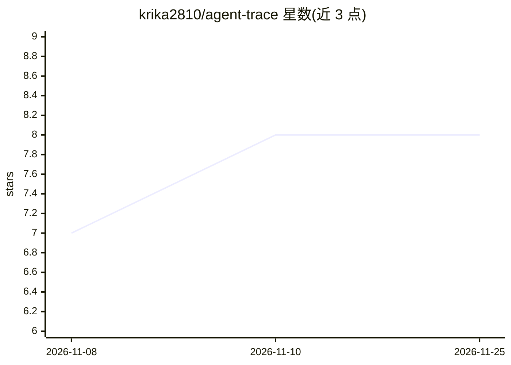

# krika2810/agent-trace

⭐ 8 · TypeScript · MIT · 推送 2026-11-05 · [GitHub](https://github.com/krika2810/agent-trace) · 个人维护

**Claude Code 追踪插件：逐条展示模型请求与工具调用**

以 Claude Code 插件（mod）形式安装，在聊天旁添加一个追踪面板，记录每次模型请求、工具调用和子代理的耗时、token 用量与 API 速率成本估算。提供 Inspect、Context 漏斗、子代理生命周期、Analytics 会话分析等视图，支持 CSV/Markdown/JSON 导出并默认脱敏。要求 Claude Code 2.1.275+ 与 Git，Python 3 仅为可选功能。追踪数据保存在本地，插件本身不发起网络请求。

## 筛选速览

| 维度 | 判定 | 备注 |
|---|---|---|
| AI 角色 | `ai-ecosystem` | LLM/agent 周边工具 |
| 许可风险 | `permissive` | MIT |
| 部署形态 | `None` |  |
| 模型依赖 | locked-api |  |
| 硬件要求 | — | 无带数字的原话,不猜 |
| 安装摩擦 | `low` | 无编译、无系统依赖或容器化 |
| 成熟度 | — | 结构信号不足 |

## 能力要点

- 逐条记录模型请求、工具调用与子代理的耗时、token 与成本估算
- Context 视图按 system prompt/tool 定义等分项展示上下文窗口占用
- Analytics 视图跨会话统计重复调用、成本与异常，五次重复标记疑似循环
- 导出默认脱敏，命令输出与最终答案默认不导出

## 适用场景

- 排查某次 prompt 中哪一步慢、哪一步开销大
- 审计子代理的执行过程与生命周期
- 按项目/模型统计历史会话的开销分布

## 场景标签

`LLM 可观测性` · 领域:评测与运维

## 证据(README 行号)

> L9: agent-trace adds a pane beside the chat that lists every step Claude takes: each model request, tool call and subage
> L76: A mod is a Claude Code plugin with TypeScript event handlers. Claude Code calls them when something happens: a sess
> L80: - Claude Code 2.1.275 or newer

## 星数曲线

2026-11-08 7 → 2026-11-25 8（+1）

---
*卡片 v1 · prompt 1.4 · 生成 2026-11-20 · 置信度 high · 依据 README sha `5fbbae1e13cf` · [字段定义](../../DATASET.md)*
