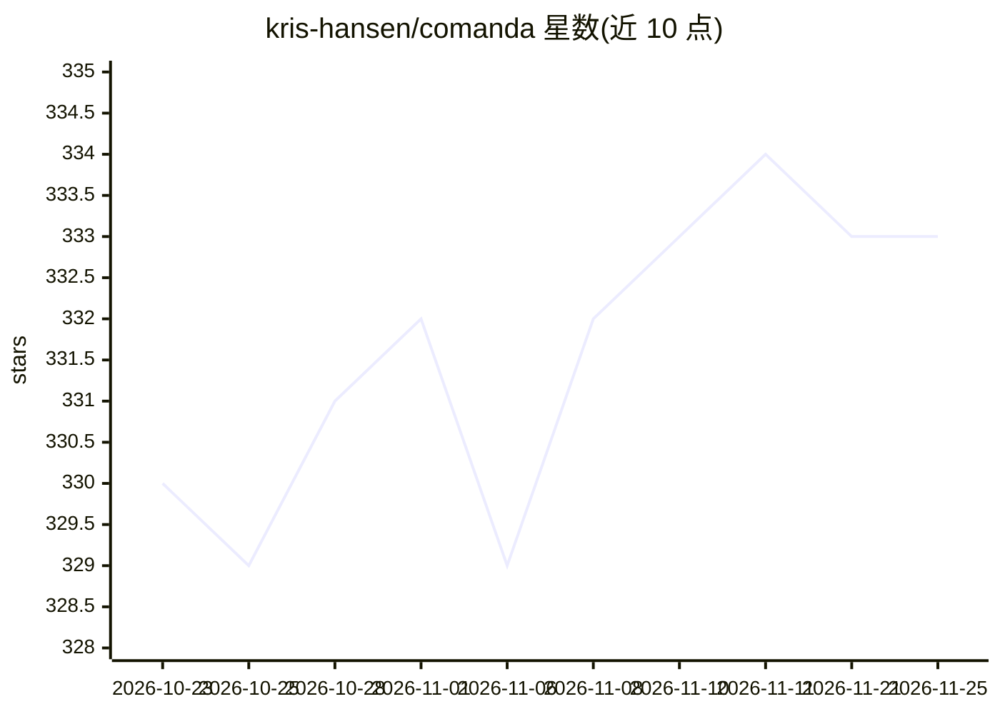

# kris-hansen/comanda

⭐ 333 · Go · MIT · 推送 2026-11-10 · [GitHub](https://github.com/kris-hansen/comanda) · [官网](https://comanda.sh) · 个人维护

**终端内编排 AI 编码代理的声明式 YAML 工作流运行时**

一个 CLI 工具，将 Claude Code、Gemini CLI、Codex、Kimi Code 等编码代理的协作流程编写为可检入版本库的 YAML 程序：可从英文描述生成工作流、以持久化状态运行 agentic loop、每轮迭代后执行测试/安全等质量门控，并支持中断后从检查点恢复。另提供代码库索引与知识图谱构建、SQLite FTS5 项目语义记忆、MCP 服务暴露、HTTP 端点运行等能力。面向在终端与 CI 中管理代理工作流的开发者，安装途径包括 Homebrew、go install 与预编译二进制。

## 筛选速览

| 维度 | 判定 | 备注 |
|---|---|---|
| AI 角色 | `ai-ecosystem` | LLM/agent 周边工具 |
| 许可风险 | `permissive` | MIT |
| 部署形态 | `library` | 以包/库形式分发 |
| 模型依赖 | local-ok | 支持本地模型 |
| 硬件要求 | — | 无带数字的原话,不猜 |
| 安装摩擦 | `low` | 无编译、无系统依赖或容器化 |
| 成熟度 | — | 结构信号不足 |

## 能力要点

- 持久化 agentic loop：状态存续、检查点恢复、质量门控
- 协调 Claude Code/Gemini CLI/Codex/Kimi Code 及 API 与本地模型
- 代码库索引与知识图谱，本地确定性抽取，localhost 可视化
- 工作流可经 MCP、HTTP 端点或 shell 管道运行

## 适用场景

- 让编码代理迭代执行功能直到测试与安全检查通过
- 多代理并行评审 git diff
- 把仓库工作流暴露为 MCP 工具供客户端调用

## 场景标签

`工作流自动化` `知识图谱` `Agent 框架` · 领域:Agent 开发

## 证据(README 行号)

> L7: > Comanda is the terminal-native runtime for durable, self-improving agent work in a repository. Describe a workflow
> L105: Comanda sits between a coding agent and an agent framework: it turns agent work into a durable, reviewable program

## 星数曲线

2026-10-23 330 → 2026-11-25 333（+3）

---
*卡片 v1 · prompt 1.4 · 生成 2026-11-25 · 置信度 high · 依据 README sha `408fda1bc01c` · [字段定义](../../DATASET.md)*
