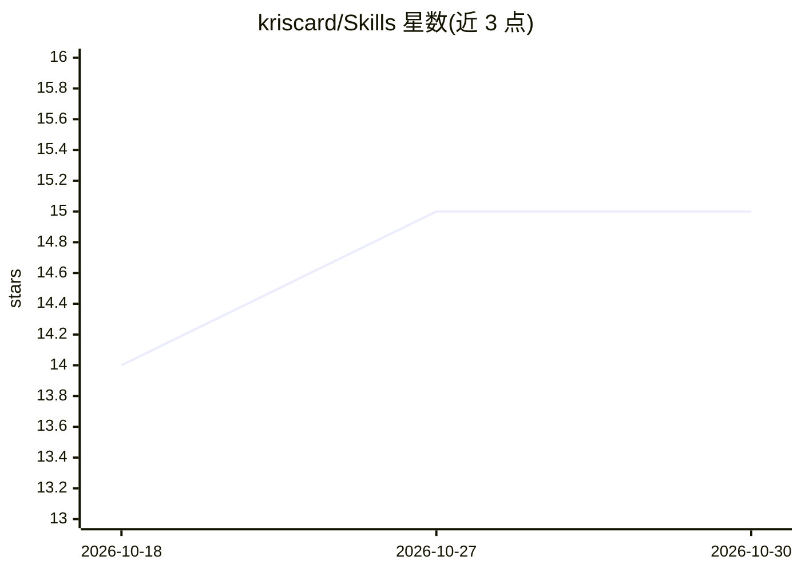

# kriscard/Skills

⭐ 15 · JavaScript · MIT · 推送 2026-10-28 · [GitHub](https://github.com/kriscard/Skills) · 个人维护

**覆盖开发/写作/生产力/知识管理的 agent 技能合集**

由个人维护的 agent 技能（skills）集合，按 Development（17 个）、Obsidian（13 个）、Writing（4 个）、Productivity（4 个）、Dotfiles（3 个）、Learning（2 个）六类组织。每个技能含 SKILL.md 与可选 references 目录，供 agent 会话中按请求自动加载或按名称调用（如 /daily、/standup）。通过 Skills CLI（npx skills@latest add）全局安装与更新，开发本仓库需 Node.js 18+ 与 pnpm 9+。README 记录了 code-review 取代 review/pr-review 的迁移说明。

## 筛选速览

| 维度 | 判定 | 备注 |
|---|---|---|
| AI 角色 | `ai-knowledge` | 知识聚合/清单类 |
| 许可风险 | `permissive` | MIT |
| 部署形态 | `library` | 以包/库形式分发 |
| 模型依赖 | — | README 未给出锁定关系 |
| 硬件要求 | — | 无带数字的原话,不猜 |
| 安装摩擦 | `low` | 无编译、无系统依赖或容器化 |
| 成熟度 | — | 结构信号不足 |

## 能力要点

- 六类共 43 个技能：开发、Obsidian、写作、生产力、Dotfiles、学习
- 每个技能由 SKILL.md 与可选 references/ 目录构成
- npx skills CLI 全局安装并支持后续 update 更新
- pnpm run validate 校验技能结构、frontmatter 与引用

## 适用场景

- 为 agent 会话添加代码审查、调试、提交、PR 等开发技能
- 在 Obsidian 知识库中做笔记分类、周回顾与会议导入
- 生成博客、文档、站会汇报等技术写作内容

## 场景标签

`代码审查` `知识库管理` `AI 写作` · 领域:编码与开发

## 证据(README 行号)

> L3: Agent skills for software development, Obsidian workflows, writing, productivity, dotfiles, and learning.
> L39: ### Development
> L115: skills/<category>/<name>/

## 星数曲线

2026-10-18 14 → 2026-10-30 15（+1）

---
*卡片 v1 · prompt 1.4 · 生成 2026-10-30 · 置信度 high · 依据 README sha `38c3315349fe` · [字段定义](../../DATASET.md)*
