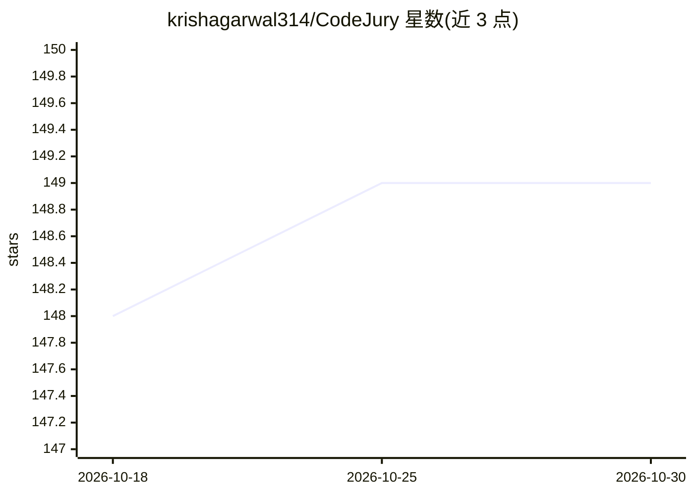

# krishagarwal314/CodeJury

⭐ 149 · Python · MIT · 推送 2026-08-06 · [GitHub](https://github.com/krishagarwal314/CodeJury) · 个人维护

**终端多智能体软件交付管线：需求拆解、实现、测试与评审门禁**

六阶段交付管线工具：Knowledge 构建持久化代码知识库（代码图＋本地嵌入语义检索＋BM25 融合），PM 澄清需求并生成工单，Planner 依据代码图制定步骤，Dev 在分支上实现，QA 独立运行测试，Review 由跨提供商的两模型陪审团一致通过才放行（pair 模式 2 席，panel 模式最多 6 席）。每阶段可在终端指定提供商与模型；编码/规划阶段可无 API key 地驱动 Claude Code、Codex、Cursor 等 CLI 的现有订阅，也支持 Anthropic 原生 API 与任意 OpenAI 兼容端点（含免费 Groq 与本地 Ollama），默认面向 Groq 免费层。pip 安装，支持 macOS/Linux/Windows。

## 筛选速览

| 维度 | 判定 | 备注 |
|---|---|---|
| AI 角色 | `ai-native` | 本体是模型或模型工具 |
| 许可风险 | `permissive` | MIT |
| 部署形态 | `library` | 以包/库形式分发 |
| 模型依赖 | local-ok | 支持本地模型 |
| 硬件要求 | — | 无带数字的原话,不猜 |
| 安装摩擦 | `low` | 无编译、无系统依赖或容器化 |
| 成熟度 | — | 结构信号不足 |

## 能力要点

- 跨提供商双评审员陪审制：两名模型互不可见意见，一致通过才放行，异议退回
- 每阶段可独立指定提供商与模型，支持无 API key 驱动 Claude Code/Codex/Cursor 等 CLI 订阅
- 一次性构建持久化代码图（158 种语言）＋本地嵌入语义检索＋BM25 的 RRF 融合
- OpenAI 兼容端点支持 OpenAI/Groq/Gemini/xAI/OpenRouter/Together/DeepSeek/本地 Ollama

## 适用场景

- 在终端用多个模型协作完成需求到 PR 的完整交付流程
- 用双模型评审门禁拦截单评审员漏掉的缺陷改动
- 在大型仓库上复用持久代码知识库降低每次任务的定位开销

## 场景标签

`多智能体` `编码 Agent` `RAG` `代码审查` · 领域:Agent 开发

## 证据(README 行号)

> L151: CodeJury isn't one agent with a reviewer bolted on. It's six stages, and you pick
> L173: you already pay for — Claude Code, Codex, Cursor, Aider, Gemini CLI — driven
> L179: DeepSeek, local Ollama). The defaults target Groq's free tier, so the whole

## 星数曲线

2026-10-18 148 → 2026-10-30 149（+1）

---
*卡片 v1 · prompt 1.4 · 生成 2026-10-22 · 置信度 mid · 依据 README sha `3e720b40d814` · [字段定义](../../DATASET.md)*
