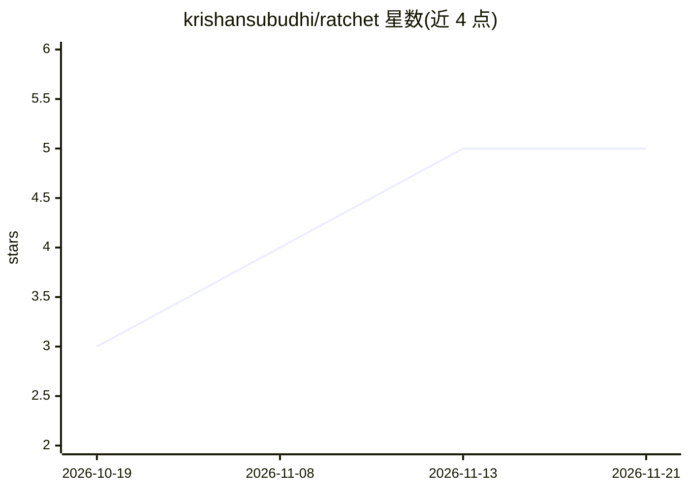

# krishansubudhi/ratchet

⭐ 5 · Python · Apache-2.0 · 推送 2026-11-18 · [GitHub](https://github.com/krishansubudhi/ratchet) · 个人维护

**给代码库设置只降不升的代码量预算，约束 coding agent 增肥**

为 Git 仓库提供代码行数预算工具：ratchet init 记录当日代码规模为上限，ratchet check 在超出预算时拒绝变更并输出超量明细。仅统计代码文件并区分 source/tests 两组，文档不计入；预算只能由人类通过 grant 提升。可选集成包括 GitHub Actions PR 门禁、pre-commit 严格模式拦截自身提交、README 徽章；另提供面向 Claude Code、Cursor、Codex、aider 等 agent 的接入文档。pip/pipx 安装，Apache-2.0 许可。

## 筛选速览

| 维度 | 判定 | 备注 |
|---|---|---|
| AI 角色 | `ai-enhanced` | 去掉 AI 部分产品仍成立 |
| 许可风险 | `permissive` | Apache-2.0 |
| 部署形态 | `library` | 以包/库形式分发 |
| 模型依赖 | — | README 未给出锁定关系 |
| 硬件要求 | — | 无带数字的原话,不猜 |
| 安装摩擦 | `low` | 无编译、无系统依赖或容器化 |
| 成熟度 | — | 结构信号不足 |

## 能力要点

- 代码量预算只降不升，超出即拒绝变更
- 人类独享预算提升权（grant 机制），agent 无法自我放行
- 区分 source/tests 分组，文档与人类自身提交不计入
- 提供 GitHub Actions 门禁、pre-commit 严格模式与 README 徽章

## 适用场景

- 团队使用 coding agent 开发时防止仓库代码量膨胀
- 在 CI/PR 流程中把代码规模作为合并门禁
- 个人开发中用严格模式约束自己的提交体积

## 场景标签

 · 领域:开发者工具/代码质量

## 证据(README 行号)

> L23: Coding agents are good at adding code and bad at deciding not to. Ratchet
> L35: 3. **Wire up your agent:** tell it: *"Set up ratchet in /path/to/repo
> L45: Only code files count, split into `source` and `tests` groups; docs never

## 星数曲线

2026-10-19 3 → 2026-11-21 5（+2）

---
*卡片 v1 · prompt 1.4 · 生成 2026-11-21 · 置信度 high · 依据 README sha `93b9eb1c462e` · [字段定义](../../DATASET.md)*
