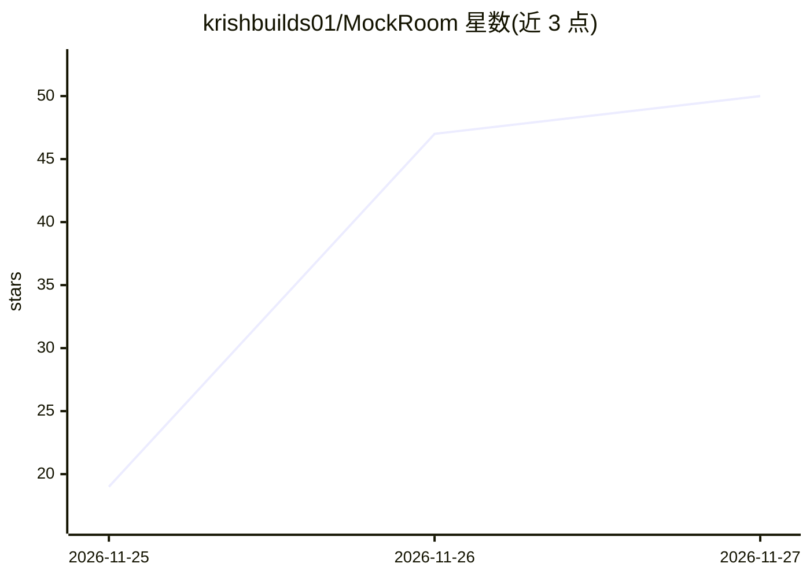

# krishbuilds01/MockRoom

⭐ 50 · TypeScript · MIT · 推送 2026-11-23 · [GitHub](https://github.com/krishbuilds01/MockRoom) · [官网](https://beta-mockroom.vercel.app) · 个人维护

**面向 CS 学生与应届生的免费 AI 模拟面试网站**

MockRoom 是一个免费网页应用，用户打开即可练习技术面试，无需下载安装。提供两个 AI 面试官（Maya 与 Rohan），支持语音面试（5 题、追问、评分反馈）、带编辑器与测试用例的编码面试、基于简历的提问、公司模式（Google/Amazon 等）以及 44 题的题库与进度记录（分数、连胜、薄弱项）。默认无需 API key，运行在本地引擎与浏览器语音上；可选配置 Gemini key 获取回复与语音。技术栈为 Next.js/TypeScript/Tailwind/Monaco/Judge0/Edge TTS。

## 筛选速览

| 维度 | 判定 | 备注 |
|---|---|---|
| AI 角色 | `ai-native` | 本体是模型或模型工具 |
| 许可风险 | `permissive` | MIT |
| 部署形态 | `library` | 以包/库形式分发 |
| 模型依赖 | — | README 未给出锁定关系 |
| 硬件要求 | — | 无带数字的原话,不猜 |
| 安装摩擦 | `low` | 无编译、无系统依赖或容器化 |
| 成熟度 | — | 结构信号不足 |

## 能力要点

- 两个 AI 面试官：提问、追问答案薄弱处、观察代码并评分
- 语音面试、编码面试、简历面试与公司模式四种练习形式
- 默认无需 API key，可选 Gemini 增强
- 题库 44 题，进度按账号跨设备保存

## 适用场景

- 求职前自己在家做模拟面试练习
- 按目标公司（如 Google/Amazon）针对性准备面试问题
- 根据自己简历生成面试问题进行演练
- 查看分数与薄弱项追踪复习进度

## 场景标签

 · 领域:教育/求职准备

## 证据(README 行号)

> L13: You practice with two AI interviewers, Maya and Rohan. They ask questions, push back when your answer is thin, watc
> L17: - Live voice interview - 5 questions, follow-ups, scored feedback

## 星数曲线

2026-11-25 19 → 2026-11-27 50（+31）

---
*卡片 v1 · prompt 1.4 · 生成 2026-11-24 · 置信度 high · 依据 README sha `2dd291c42543` · [字段定义](../../DATASET.md)*
