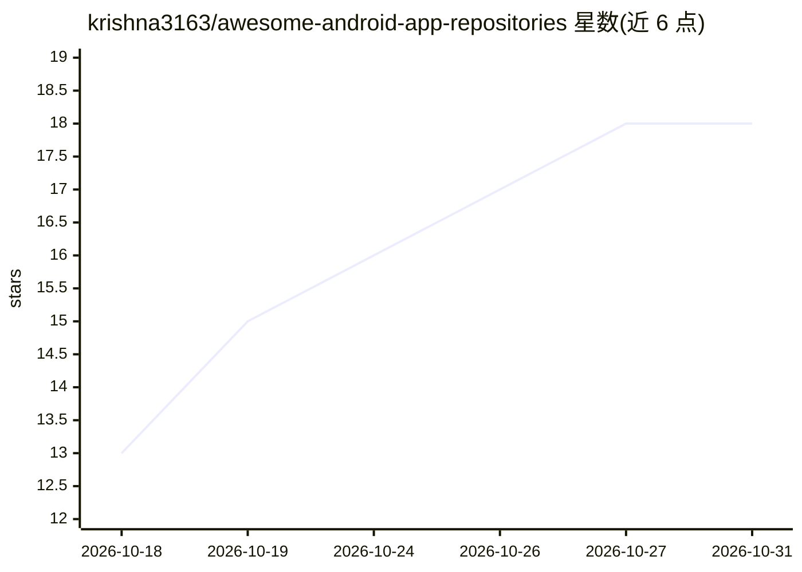

# krishna3163/awesome-android-app-repositories

⭐ 18 · Python · 推送 2026-10-22 · [GitHub](https://github.com/krishna3163/awesome-android-app-repositories) · [官网](https://github.com/krishna3163/awesome-android-app-repositories#readme) · 个人维护

**从 Telegram 自动同步的开源 Android 应用与工具策展目录**

自动化的开源应用策展目录：从 Telegram 频道发现并收录 Android 应用、桌面工具、Web 工具与开发者项目，累计收录 17,027 条记录、15,582 个分类标签。通过多步模糊匹配去重，所有条目以机器可读 JSON（data/apps.json）存储，并 24/7 自动同步更新。条目包含开发者信息、仓库链接、官网、功能列表与截图，README 展示热门趋势仓库与最新发现，部分收录项目含 AI 能力（如 AI 字幕、浏览器自动化 agent）。

## 筛选速览

| 维度 | 判定 | 备注 |
|---|---|---|
| AI 角色 | `ai-knowledge` | 知识聚合/清单类 |
| 许可风险 | `none` | — |
| 部署形态 | `None` |  |
| 模型依赖 | — | README 未给出锁定关系 |
| 硬件要求 | — | 无带数字的原话,不猜 |
| 安装摩擦 | `medium` | 含编译或系统依赖之一 |
| 成熟度 | — | 结构信号不足 |

## 能力要点

- 累计收录 17,027 个应用与项目条目
- 多步模糊匹配去重，单一干净条目跟踪
- 全部记录以 JSON 格式存储于 data/apps.json
- 24/7 监控 Telegram 并自动同步更新

## 适用场景

- 发现新开源 Android 应用与开发者工具
- 浏览热门趋势开源仓库与最新收录项目
- 以 JSON 数据源形式获取结构化项目目录

## 场景标签

`精选清单` · 领域:学习与行业

## 证据(README 行号)

> L21: This repository is an **automated, curated catalog** of newly discovered open-source applications, power tools, web
> L30: - 📦 **Total Discovered Apps & Projects:** `17027`

## 星数曲线

2026-10-18 13 → 2026-10-31 18（+5）

---
*卡片 v1 · prompt 1.4 · 生成 2026-10-29 · 置信度 high · 依据 README sha `c473e8509407` · [字段定义](../../DATASET.md)*
