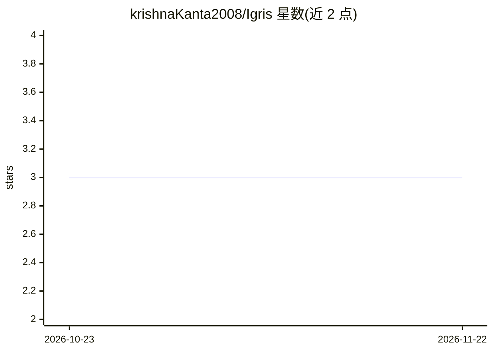

# krishnaKanta2008/Igris

⭐ 3 · Rust · NOASSERTION · 推送 2026-10-15 · [GitHub](https://github.com/krishnaKanta2008/Igris) · [官网](https://igris-os.mintlify.app) · 个人维护

**AI 原生 Linux 环境的结构化系统访问层与权限模型**

在 Linux 内核之上逐步构建的 AI 原生系统层：以 Rust 实现核心守护进程（igrisd）、默认拒绝权限代理（igris-permd）与 CLI 客户端（igrisctl），通过结构化 Unix-socket IPC 暴露文件系统、进程与事件观察三类工具，全部操作走逐工具授权与审计日志。Python 编写的 AI agent 层目前仅为 Phase 0 脚手架。Linux/WSL2 开发环境，Rust 与 Python 3.10+ 构建，Apache-2.0 许可。

## 筛选速览

| 维度 | 判定 | 备注 |
|---|---|---|
| AI 角色 | `ai-ecosystem` | LLM/agent 周边工具 |
| 许可风险 | `none` | NOASSERTION |
| 部署形态 | `None` |  |
| 模型依赖 | — | README 未给出锁定关系 |
| 硬件要求 | — | 无带数字的原话,不猜 |
| 安装摩擦 | `low` | 无编译、无系统依赖或容器化 |
| 成熟度 | `idea` | |

## 能力要点

- 默认拒绝权限模型：每类工具为独立能力，需显式策略授权
- 结构化工具接口（fs.*/process.*/events.*），禁止 AI 直接执行原始 shell 命令
- Append-only JSON Lines 审计日志，逐请求记录决策
- 危险操作（写文件/删除/发信号）要求显式确认

## 适用场景

- 为 AI agent 提供最小权限的系统操作工具层
- 研究 AI 与操作系统集成的权限治理机制
- 审计 AI 对文件系统与进程的每次访问

## 场景标签

 · 领域:操作系统/AI 系统基础设施

## 证据(README 行号)

> L3: Igris OS is a Linux-based, AI-native operating system environment. The Linux
> L104: |`agent/`|Python|AI agent layer: orchestration, planning, memory, model abstraction|
> L175: - **Phase 4** — AI agent layer (scaffold only)

## 星数曲线

2026-10-23 3 → 2026-11-22 3（+0）

---
*卡片 v1 · prompt 1.4 · 生成 2026-11-21 · 置信度 mid · 依据 README sha `14b51dff7a3b` · [字段定义](../../DATASET.md)*
