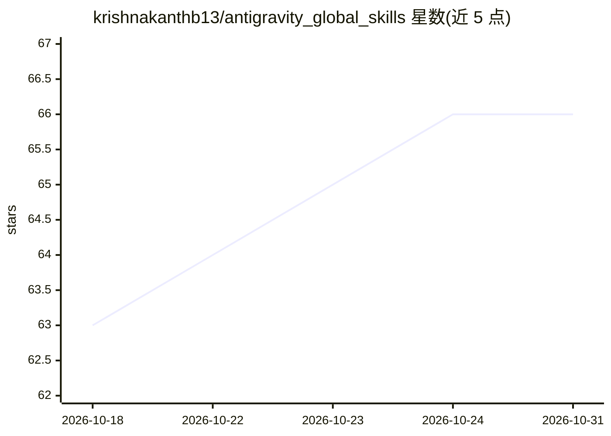

# krishnakanthb13/antigravity_global_skills

⭐ 66 · Python · NOASSERTION · 推送 2026-07-04 · [GitHub](https://github.com/krishnakanthb13/antigravity_global_skills) · [官网](https://antigravity.google/docs/skills) · 个人维护

**Antigravity IDE 的 22+ 个 agent 技能集：斜杠命令自动化开发任务**

面向 Antigravity IDE 的自定义技能集合，以 SKILL.md（YAML frontmatter 的 markdown 指令集）加工作流映射文件的形式提供，通过斜杠命令、自然语言或显式指令三种方式触发。技能覆盖代码审查、5 步调试协议、UI/UX 设计、安全审计、测试脚手架、版本发布、文档更新等开发任务。安装方式为克隆仓库后将内容复制到 ~/.gemini/antigravity/skills/ 目录。仓库由 create_skill 元技能递归生成其余技能。

## 筛选速览

| 维度 | 判定 | 备注 |
|---|---|---|
| AI 角色 | `ai-ecosystem` | LLM/agent 周边工具 |
| 许可风险 | `none` | NOASSERTION |
| 部署形态 | `None` |  |
| 模型依赖 | — | README 未给出锁定关系 |
| 硬件要求 | — | 无带数字的原话,不猜 |
| 安装摩擦 | `low` | 无编译、无系统依赖或容器化 |
| 成熟度 | — | 结构信号不足 |

## 能力要点

- 22+ 个技能通过斜杠命令/自然语言/显式指令触发
- 技能以 SKILL.md markdown 指令集 + 工作流映射实现
- 涵盖代码审查、调试、安全审计、测试、发布管理等任务类别
- 提供 create_skill 元技能交互式生成新技能

## 适用场景

- 在 Antigravity IDE 中用斜杠命令执行标准化代码审查或调试流程
- 自动化版本发布、发布说明与文档更新
- 按可复用技能规范团队的开发工作流

## 场景标签

`工作流自动化` `代码审查` `提示工程` · 领域:Agent 开发

## 证据(README 行号)

> L3: This repository contains a collection of custom "skills" for Antigravity, designed to automate common development ta
> L41: * **/[skill_name]/SKILL.md**: The definition and instructions for a specific skill.

## 星数曲线

2026-10-18 63 → 2026-10-31 66（+3）

---
*卡片 v1 · prompt 1.4 · 生成 2026-10-24 · 置信度 high · 依据 README sha `f30d3be93ef1` · [字段定义](../../DATASET.md)*
