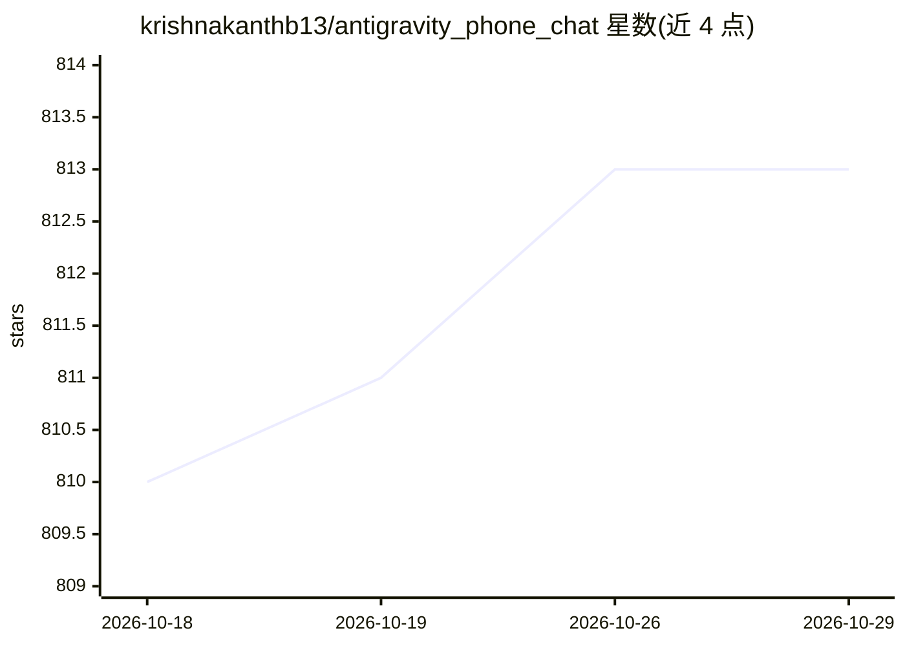

# krishnakanthb13/antigravity_phone_chat

⭐ 813 · JavaScript · NOASSERTION · 推送 2026-06-16 · [GitHub](https://github.com/krishnakanthb13/antigravity_phone_chat) · 个人维护

**把桌面 Antigravity AI 会话镜像到手机并远程控制的工具**

通过 Chrome DevTools Protocol (CDP) 读取已运行的桌面 Antigravity 会话，以亚 100ms 快照镜像到手机浏览器，支持发送消息、停止生成、切换模型/模式、远程点击 Allow/Deny 等权限按钮与滚动同步。本地 Wi-Fi 直连或经 ngrok/Cloudflare/Pinggy 隧道实现外网访问，带密码保护、HTTPS 自签证书与 CSP 防护。以 Windows bat / macOS-Linux sh 启动脚本运行，自动创建 Python venv。是 Antigravity Shit-Chat 的 fork/扩展，GPL v3。

## 筛选速览

| 维度 | 判定 | 备注 |
|---|---|---|
| AI 角色 | `ai-ecosystem` | LLM/agent 周边工具 |
| 许可风险 | `none` | NOASSERTION |
| 部署形态 | `None` |  |
| 模型依赖 | — | README 未给出锁定关系 |
| 硬件要求 | — | 无带数字的原话,不猜 |
| 安装摩擦 | `low` | 无编译、无系统依赖或容器化 |
| 成熟度 | — | 结构信号不足 |

## 能力要点

- CDP 镜像桌面会话到手机，支持远程控制与滚动同步
- ngrok / Cloudflare Tunnel / Pinggy 三种外网隧道，带密码与 HTTPS
- 本地图片转 Base64 渲染、健康检查端点、优雅关闭
- 右键菜单脚本集成（Windows/Linux/macOS Automator）

## 适用场景

- 离开工位时在手机上查看 AI 的生成进度
- 在手机上远程批准/拒绝 AI 的权限请求
- 通过移动数据从外部网络接入家里的 AI 会话

## 场景标签

 · 领域:AI 工具/远程访问

## 证据(README 行号)

> L6: **Antigravity Phone Connect** is a high-performance, real-time mobile monitor and remote control for your Antigravit
> L8: - **🚀 Lightning Fast Snapshots**: Sub-100ms mirroring of the Antigravity chat via Chrome DevTools Protocol (CDP).
> L179: - **Bridge Mechanism**: It uses the **Chrome DevTools Protocol (CDP)** to mirror the UI of your *already-running* 

## 星数曲线

2026-10-18 810 → 2026-10-29 813（+3）

---
*卡片 v1 · prompt 1.4 · 生成 2026-10-21 · 置信度 high · 依据 README sha `91d4b5419a65` · [字段定义](../../DATASET.md)*
