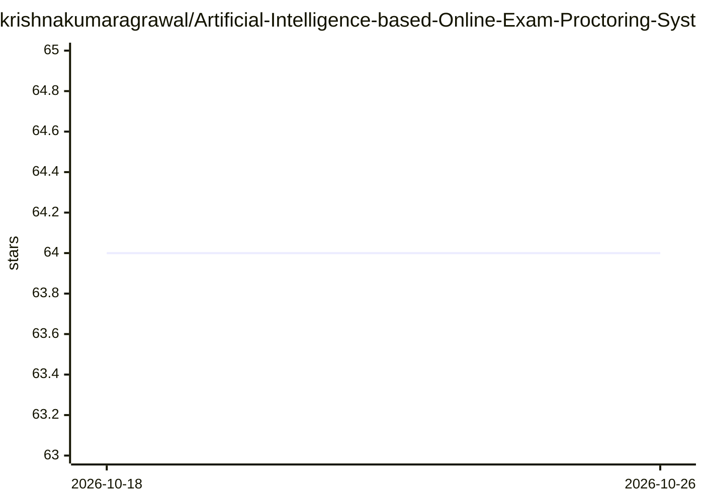

# krishnakumaragrawal/Artificial-Intelligence-based-Online-Exam-Proctoring-System

⭐ 64 · Python · 推送 2026-05-25 · [GitHub](https://github.com/krishnakumaragrawal/Artificial-Intelligence-based-Online-Exam-Proctoring-System) · 个人维护

**用计算机视觉监测在线考试考生行为的监考系统**

基于 Python 与计算机视觉的在线考试监考系统，面向需要远程组织考试的教育者与管理者。通过 Dlib 人脸检测、视线追踪、嘴部追踪、眨眼检测、头部姿态估计、YOLO 物体检测与音频检测实时监测考生行为，识别可疑举动；并将考试期间考生全部活动与行为记录写入 activity.txt 日志文件，供考后审查分析。系统包含 Flask 服务器、SQL 数据库与 Web 前端（HTML/CSS/JS）。README 未提供安装或运行命令。

## 筛选速览

| 维度 | 判定 | 备注 |
|---|---|---|
| AI 角色 | `ai-native` | 本体是模型或模型工具 |
| 许可风险 | `none` | — |
| 部署形态 | `None` |  |
| 模型依赖 | — | README 未给出锁定关系 |
| 硬件要求 | — | 无带数字的原话,不猜 |
| 安装摩擦 | `low` | 无编译、无系统依赖或容器化 |
| 成熟度 | — | 结构信号不足 |

## 能力要点

- Dlib 人脸检测、视线追踪、头部姿态估计等 7 类监测功能
- YOLO 物体检测与音频检测
- 生成 activity.txt 考试行为日志供考后审查
- Flask 服务器 + SQL 数据库 + Web 前端

## 适用场景

- 远程考试中实时监测考生可疑行为
- 考后通过活动日志审查考生行为
- 教育机构组织在线考试时留存监考记录

## 场景标签

`人脸识别` `目标检测` · 领域:感知与多模态

## 证据(README 行号)

> L2: AI-Based Online Exam Proctoring System is an innovative project designed to maintain the integrity and security of o
> L12: 6. Object Detection using Yolo

## 星数曲线

2026-10-18 64 → 2026-10-26 64（+0）

---
*卡片 v1 · prompt 1.4 · 生成 2026-10-24 · 置信度 mid · 依据 README sha `b636969b97fa` · [字段定义](../../DATASET.md)*
