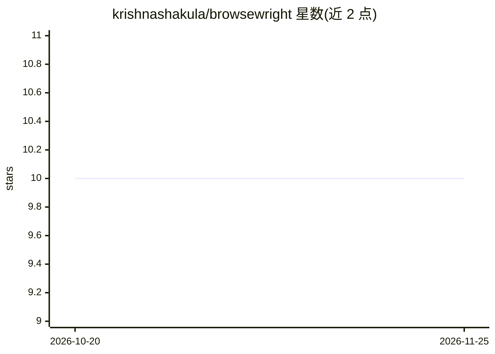

# krishnashakula/browsewright

⭐ 10 · Python · MIT · 推送 2026-07-25 · [GitHub](https://github.com/krishnashakula/browsewright) · 个人维护

**让 LLM 驱动真实浏览器完成表单填写并返回结构化数据**

MIT 许可的 Python 库，提供意图驱动的浏览器自动化与网页抓取：用户给出 URL 和自然语言目标，LLM 经 nodriver 驱动本机 Chrome 导航、填写并提交表单、解析结果为结构化 JSON，无需编写选择器。先尝试开放 API/RSS/公共归档等低成本路径，需要时才启动浏览器；默认 polite 模式检查 robots.txt 并限速，绕过 CDN 反爬仅在 --aggressive 下启用。提供 CLI、Python 库、5 个内置任务子命令（watch/enrich/form/track/brand）及 MCP 服务器，需 Python 3.10+、本机 Chrome 与 Anthropic API key。

## 筛选速览

| 维度 | 判定 | 备注 |
|---|---|---|
| AI 角色 | `ai-native` | 本体是模型或模型工具 |
| 许可风险 | `permissive` | MIT |
| 部署形态 | `library` | 以包/库形式分发 |
| 模型依赖 | locked-api |  |
| 硬件要求 | — | 无带数字的原话,不猜 |
| 安装摩擦 | `low` | 无编译、无系统依赖或容器化 |
| 成熟度 | — | 结构信号不足 |

## 能力要点

- 自然语言意图驱动真实 Chrome，返回结构化 JSON 而非原始 HTML
- LLM 读取表单字段标签并按用户 profile 填写、提交、解析结果
- 先走免费 API/归档捷径，仅在需要时启动浏览器（基准：50 站共 $0.047）
- 内置 5 个业务任务子命令与 MCP 服务器（bw-mcp）

## 适用场景

- 抓取无 API 的网站数据并直接得到 JSON
- 用 profile 自动填写并提交政府/机构表单
- 定时监控竞品价格与页面变更并推送 Slack 告警
- 作为 MCP 工具给 Claude Desktop/Code 提供 read_page 能力

## 场景标签

`浏览器自动化` `网页抓取` · 领域:效率与自动化

## 证据(README 行号)

> L14: **Browsewright is an open-source, MIT-licensed Python library for intent-driven browser automation and AI web scrap
> L107: The first browser run launches Chrome via `nodriver` (Chrome must be installed).

## 星数曲线

2026-10-20 10 → 2026-11-25 10（+0）

---
*卡片 v1 · prompt 1.4 · 生成 2026-11-20 · 置信度 high · 依据 README sha `b97e88134d9d` · [字段定义](../../DATASET.md)*
