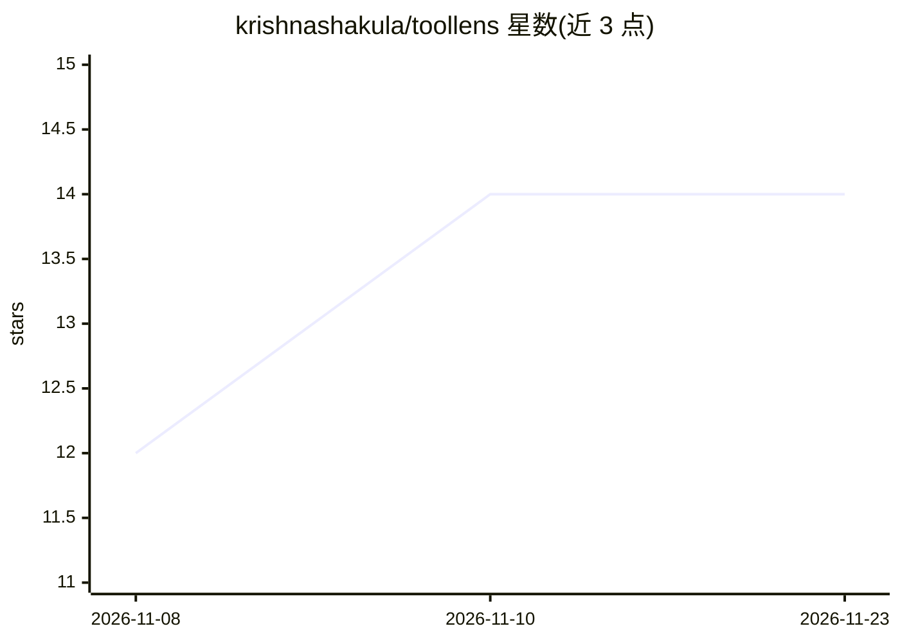

# krishnashakula/toollens

⭐ 14 · Rust · MIT · 推送 2026-11-15 · [GitHub](https://github.com/krishnashakula/toollens) · [官网](https://github.com/krishnashakula/toollens/blob/main/bench/real/tool-tax.md) · 个人维护

**Rust 编写的 MCP 工具网关：海量工具按需发现与策略化执行**

位于 agent 与 MCP 服务器之间的网关：把任意数量服务器收拢到身后，向 agent 只暴露 discover_tools/inspect_tool/invoke_tool 三个工具。检索用 BM25、Ollama 语义向量或混合（RRF），并基于 schema 边与运行时观测边扩展依赖工具。每次 invoke 前检查 policy 并校验参数，无 policy 默认全拒。提供 toollens tax 命令测量现有服务器工具定义的 token 开销，带本地 Web 控制台与 SQLite 审计日志。基准为 110 个厂商服务器、2,468 工具、28 任务各跑五次。已知限制：Claude Desktop 未测试、lazy 模式依赖缓存目录、maxLive 非硬上限。

## 筛选速览

| 维度 | 判定 | 备注 |
|---|---|---|
| AI 角色 | `ai-ecosystem` | LLM/agent 周边工具 |
| 许可风险 | `permissive` | MIT |
| 部署形态 | `self-host` | docker 或自建部署 |
| 模型依赖 | local-ok | 支持本地模型 |
| 硬件要求 | — | 无带数字的原话,不猜 |
| 安装摩擦 | `low` | 无编译、无系统依赖或容器化 |
| 成熟度 | — | 结构信号不足 |

## 能力要点

- 代理只见 3 个工具（discover/inspect/invoke），替代全量工具定义下发
- 依赖图扩展：schema 字段边与运行时观测边补齐调用链
- policy 检查、JSON schema 参数校验、审计日志不记录参数值
- toollens tax 测量现有 MCP 服务器的每请求 token 开销
- lazy 模式：SQLite 缓存工具索引，按需启停服务器

## 适用场景

- 我的 agent 接了大量 MCP 服务器导致工具定义超 token 上限
- 在调用前对工具执行细粒度允许/拒绝策略控制
- 审计现有 MCP 服务器的 token 成本并做基准复现

## 场景标签

`模型网关` · 领域:Agent 开发

## 证据(README 行号)

> L5: **An MCP gateway in Rust. Put any number of MCP servers behind it: your agent discovers, inspects and
> L23: ToolLens sits between the agent and your servers and shows the agent three tools instead:

## 星数曲线

2026-11-08 12 → 2026-11-23 14（+2）

---
*卡片 v1 · prompt 1.4 · 生成 2026-11-18 · 置信度 mid · 依据 README sha `dc7a446c3c24` · [字段定义](../../DATASET.md)*
