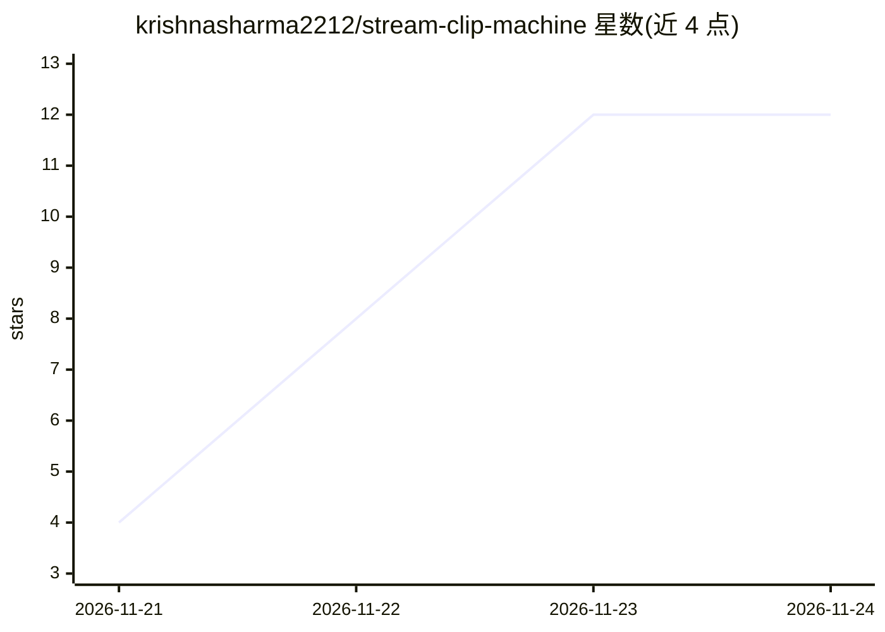

# krishnasharma2212/stream-clip-machine

⭐ 12 · Python · MIT · 推送 2026-11-19 · [GitHub](https://github.com/krishnasharma2212/stream-clip-machine) · [官网](https://krishnasharma.online) · 个人维护

**全天监控直播聊天热点并用 Claude 剪成竖屏短视频自动发布**

在 Windows 笔记本上 24/7 运行的 Python 自动化系统：发现热门 GTA 6 直播并录制滚动 8 分钟片段，实时监测聊天爆发（语速 z 值、参与者多样性、反应占比）标记精彩时刻，随后由 Claude Code 会话完成片段筛选、剪辑决策与竖屏字幕视频生成，经 ffmpeg 渲染后按每日最多 5 个时段自动上传 YouTube Shorts（Chrome/Playwright 扩展登录），Instagram 发布需另接 AutoDM 服务器。仅剪辑允许的主播，提供屏蔽名单与署名机制。

## 筛选速览

| 维度 | 判定 | 备注 |
|---|---|---|
| AI 角色 | `ai-native` | 本体是模型或模型工具 |
| 许可风险 | `permissive` | MIT |
| 部署形态 | `None` |  |
| 模型依赖 | locked-api |  |
| 硬件要求 | — | 无带数字的原话,不猜 |
| 安装摩擦 | `medium` | 含编译或系统依赖之一 |
| 成熟度 | — | 结构信号不足 |

## 能力要点

- 基于聊天爆发的实时精彩时刻检测（z_threshold、reaction_share 可调）
- Claude Code 会话执行筛选、剪辑与上传修复，决策记录在 edit.json
- 每日 5 个固定发布时段与 hook 样式 A/B 测试及浏览量报告
- discovery.block 屏蔽机制与主播署名链接

## 适用场景

- 无人值守地把直播精彩瞬间剪成短视频并发布
- 为多个主播持续产出带字幕的竖屏短片
- 换游戏名称后复用同一套流程剪辑其他游戏直播

## 场景标签

`浏览器自动化` `视频生成` `工作流自动化` · 领域:效率与自动化

## 证据(README 行号)

> L3: A laptop that runs 24/7: it watches the biggest live GTA 6 streams, notices the moment a streamer's chat explodes,
> L4: cuts that moment, has **Claude** turn it into a vertical Short with a hook and captions, and posts up to 5 a day to
> L28: - Claude Code with a paid Claude plan (triage + editing run as Claude Code sessions).

## 星数曲线

2026-11-21 4 → 2026-11-24 12（+8）

---
*卡片 v1 · prompt 1.4 · 生成 2026-11-21 · 置信度 high · 依据 README sha `132c274a6373` · [字段定义](../../DATASET.md)*
