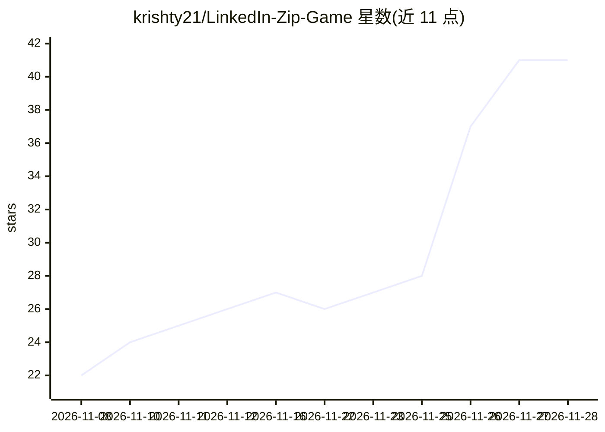

# krishty21/LinkedIn-Zip-Game

⭐ 41 · Jupyter Notebook · 推送 2026-10-24 · [GitHub](https://github.com/krishty21/LinkedIn-Zip-Game) · 个人维护

**AI 自动求解 LinkedIn Zip 拼图游戏并代为操作浏览器**

面向解谜游戏爱好者的端到端自动求解器，以两个 Jupyter Notebook 组织：其一用合成谜题自博弈训练 AlphaZero 风格的双头（策略/价值）4 层残差 CNN，导出约 386 KB 权重；其二通过 Playwright 从页面 DOM 提取棋盘，结合洪水填充连通性检查、死锁检测、Warnsdorff 排序与 CNN 先验偏置的深度优先分支定界搜索求解，再以贝塞尔曲线模拟人手拖拽自动完成游戏。支持游客模式与登录每日谜题模式。需 Python 3.10+、PyTorch、Playwright。

## 筛选速览

| 维度 | 判定 | 备注 |
|---|---|---|
| AI 角色 | `ai-native` | 本体是模型或模型工具 |
| 许可风险 | `permissive` | — |
| 部署形态 | `library` | 以包/库形式分发 |
| 模型依赖 | — | README 未给出锁定关系 |
| 硬件要求 | — | 无带数字的原话,不猜 |
| 安装摩擦 | `low` | 无编译、无系统依赖或容器化 |
| 成熟度 | — | 结构信号不足 |

## 能力要点

- AlphaZero 风式策略/价值 CNN 与启发式 DFS 混合求解架构
- DOM 元素直接提取棋盘，不依赖 OCR
- Playwright 生成拟人贝塞尔曲线鼠标拖拽执行解法
- 8x8 实局求解延迟 < 25 ms

## 适用场景

- 自动完成 LinkedIn 每日 Zip 拼图
- 研究深度学习先验与启发式搜索的结合
- 学习 Playwright DOM 提取与浏览器自动化

## 场景标签

`浏览器自动化` · 领域:效率与自动化

## 证据(README 行号)

> L9: An autonomous, end-to-end artificial intelligence solver for the daily **LinkedIn Zip** puzzle game. Built with a hy
> L35: * **AlphaZero Composite Loss:** Joint optimization of Cross-Entropy policy loss and Mean Squared Error value loss.

## 星数曲线

2026-11-08 22 → 2026-11-28 41（+19）

---
*卡片 v1 · prompt 1.4 · 生成 2026-11-18 · 置信度 high · 依据 README sha `32d5f5a3e35e` · [字段定义](../../DATASET.md)*
