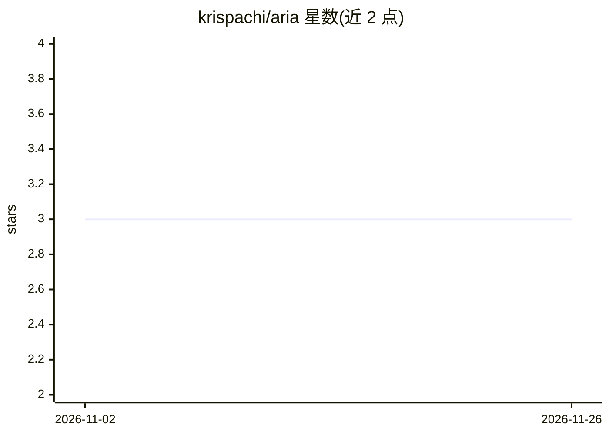

# krispachi/aria

⭐ 3 · TypeScript · MIT · 推送 2026-10-27 · [GitHub](https://github.com/krispachi/aria) · 个人维护

**VS Code 内联审查扩展：逐条接受/拒绝终端 CLI 编码 agent 的文件改动**

ARIA 是运行在 VS Code 中的审查层：终端编码 agent（OpenCode、Claude Code、Codex CLI、Cursor CLI 等）直接写文件时，ARIA 通过各 CLI 的用户级 hook 收到改动通知，与内存中的基线快照做对比，以红/绿行内 diff 呈现改动组，由用户逐组、逐文件或全部接受/拒绝，也可先手动编辑再决定；接受的结果成为新基线。不依赖 Git，不调用 AI 模型、不上传代码、无遥测。支持撤销、重启恢复、按 agent 开关；限制包括不支持虚拟工作区、跳过二进制与超大小文件、shell 命令改动无法归属。

## 筛选速览

| 维度 | 判定 | 备注 |
|---|---|---|
| AI 角色 | `ai-ecosystem` | LLM/agent 周边工具 |
| 许可风险 | `permissive` | MIT |
| 部署形态 | `None` |  |
| 模型依赖 | locked-api |  |
| 硬件要求 | — | 无带数字的原话,不猜 |
| 安装摩擦 | `low` | 无编译、无系统依赖或容器化 |
| 成熟度 | — | 结构信号不足 |

## 能力要点

- 通过各 CLI 的用户级 hook 捕获改动，无需 Git，hook 不写入项目
- 行内 diff 审查，支持按改动组/文件/全部接受或拒绝，决策前可直接编辑代码
- 提供撤销、待审恢复、每 agent 独立开关与备份保留既有 hook
- 声明无 AI 调用、无上传、无遥测，本地存储事件与快照

## 适用场景

- 让 Claude Code / Codex CLI 等 agent 改代码后逐条审查再落盘
- 在没有 Git 的工作目录里对 agent 改动做接受/拒绝
- 多个 CLI agent 并用时按 agent 分别启用或关闭审查

## 场景标签

`代码审查` · 领域:编码与开发

## 证据(README 行号)

> L23: **ARIA = A Review Inline Agent.** It is the reviewer that sits between a CLI coding agent and your code:
> L36: 1. When a folder opens, ARIA takes a **baseline snapshot** of your text files (in memory, nothing written to the pr
> L54: ## Supported agents

## 星数曲线

2026-11-02 3 → 2026-11-26 3（+0）

---
*卡片 v1 · prompt 1.4 · 生成 2026-11-22 · 置信度 high · 依据 README sha `627ca31dc4e8` · [字段定义](../../DATASET.md)*
