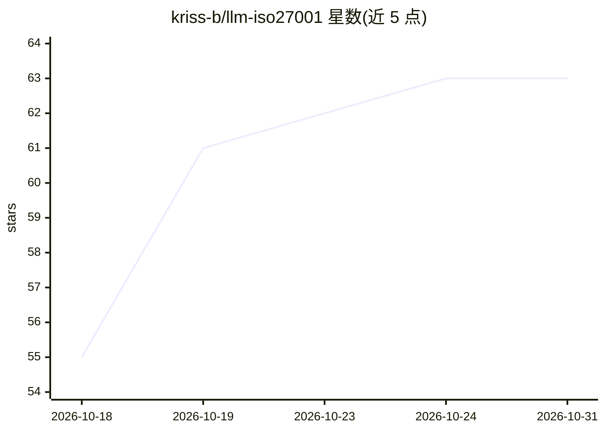

# kriss-b/llm-iso27001

⭐ 63 · MIT · 推送 2026-10-27 · [GitHub](https://github.com/kriss-b/llm-iso27001) · 个人维护

**供 LLM Agent 克隆并运营的 ISO 27001 信息安全管理体系模板**

纯 Markdown 组成的 ISMS 模板仓库，覆盖 ISO 27001 的方针、程序、风险与事件登记、运行记录与逐控制项的可执行合规检查，并提供 ISO 42001（AI 管理体系）、EN 18286、NIS2、AIUC-1 可选叠加层。设计为被任意 LLM Agent（如 Claude Code、Codex 等）克隆后定制：替换占位公司、改写方针、填登记表、运行检查并持续维护；以 git 历史为审计线索，声明需人类安全专家监督，不替代专家。

## 筛选速览

| 维度 | 判定 | 备注 |
|---|---|---|
| AI 角色 | `ai-knowledge` | 知识聚合/清单类 |
| 许可风险 | `permissive` | MIT |
| 部署形态 | `None` |  |
| 模型依赖 | — | README 未给出锁定关系 |
| 硬件要求 | — | 无带数字的原话,不猜 |
| 安装摩擦 | `low` | 无编译、无系统依赖或容器化 |
| 成熟度 | — | 结构信号不足 |

## 能力要点

- 93 个控制项映射到 SoA 索引与实现状态
- ISO 42001 / EN 18286 / NIS2 / AIUC-1 以叠加层而非平行体系扩展
- checks/ 目录含逐控制项的可执行合规检查
- 通过 git remote/tag 流程跟踪上游模板更新

## 适用场景

- 公司寻求 ISO 27001 认证时用 LLM Agent 搭建并运营 ISMS
- 合规或安全团队以 git 为审计线索维护方针与登记表
- 审计前批量运行合规检查获取整体符合情况

## 场景标签

`网络安全` · 领域:学习与行业

## 证据(README 行号)

> L8: This repository is a lightweight and LLM-maintainable Information Security Management System (ISMS) — covering polic
> L12: Everything is plain markdown, version-controlled with git, and intentionally kept free of tooling, build steps, or 

## 星数曲线

2026-10-18 55 → 2026-10-31 63（+8）

---
*卡片 v1 · prompt 1.4 · 生成 2026-10-24 · 置信度 high · 依据 README sha `4cb70a9d16b0` · [字段定义](../../DATASET.md)*
