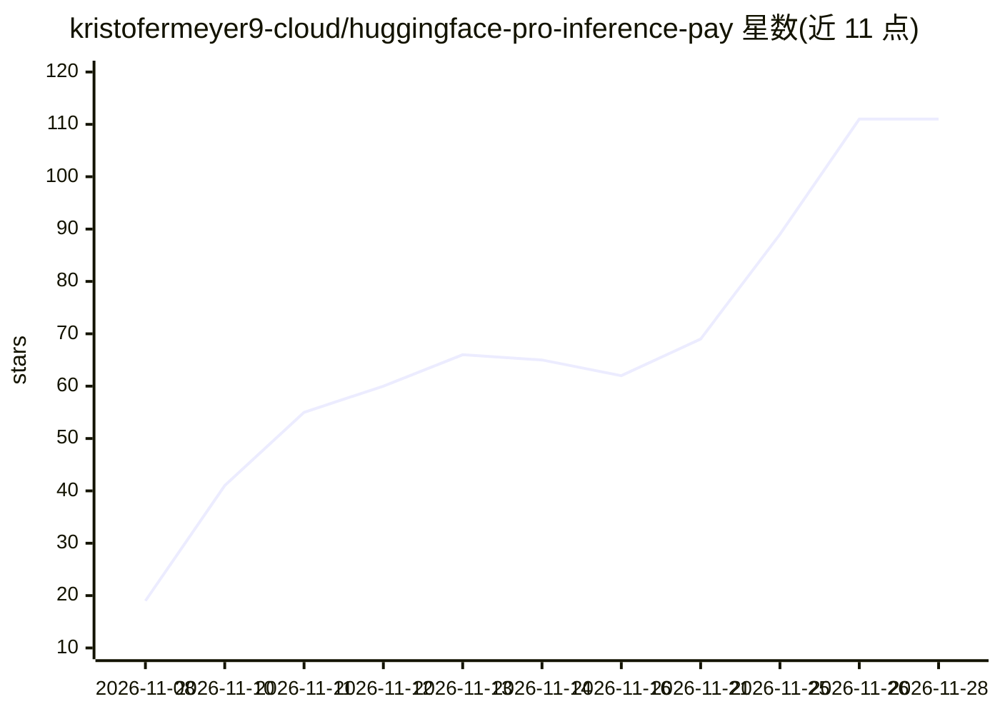

# kristofermeyer9-cloud/huggingface-pro-inference-pay

⭐ 111 · 推送 2026-11-04 · [GitHub](https://github.com/kristofermeyer9-cloud/huggingface-pro-inference-pay) · [官网](https://app.coregold.io/signup?invite_code=ADvlj9b) · 个人维护 · 中文 README

**推广 CoreGold 虚拟卡支付 HF 推理端点费用的指南**

以指南形式介绍 Hugging Face Pro 订阅与 Dedicated Inference Endpoints 的按秒计费扣费问题（长尾扣费、发卡行拦截拒付），并给出用 CoreGold 商业卡段开通虚拟卡、设定单卡额度上限、绑定 HF 账单的三步操作流程，末尾附开卡控制台入口与一串十六进制字符串。本质是支付产品的导流文案，不含可安装的软件。

## 筛选速览

| 维度 | 判定 | 备注 |
|---|---|---|
| AI 角色 | `ai-knowledge` | 知识聚合/清单类 |
| 许可风险 | `none` | — |
| 部署形态 | `None` |  |
| 模型依赖 | — | README 未给出锁定关系 |
| 硬件要求 | — | 无带数字的原话,不猜 |
| 安装摩擦 | `low` | 无编译、无系统依赖或容器化 |
| 成熟度 | — | 结构信号不足 |

## 能力要点

- 指出推理端点按秒计费与银行防盗刷拦截导致的扣费风险
- 给出 CoreGold 商业卡段的三步开通与绑定流程（入金 USDT/开专卡/绑账单）
- 宣称单卡硬限额可在超预算时由发卡层拒付止损

## 适用场景

- 想了解 HF 推理端点计费扣费机制的开发者
- 需要为 HF 账单绑定可限额虚拟卡的用户

## 场景标签

 · 领域:AI 基础设施支付/推广文案

## 证据(README 行号)

> L2: Hugging Face Pro 与 Inference Endpoints 扣费指南：解决部署模型卡密拒付与弹性计费穿透。
> L5: 在 Hugging Face 租用 Dedicated Inference Endpoints（专用推理端点）部署开源模型，是 AI 团队常用的轻量化方案。
> L26: 1. **入金**：进入 CoreGold 控制台 充入 USDT，秒转 USD 资金。

## 星数曲线

2026-11-08 19 → 2026-11-28 111（+92）

---
*卡片 v1 · prompt 1.4 · 生成 2026-11-18 · 置信度 mid · 依据 README sha `fbf67190861e` · [字段定义](../../DATASET.md)*
