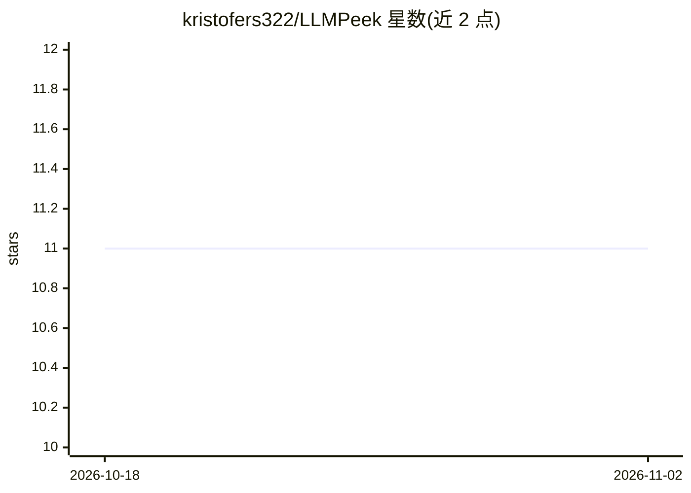

# kristofers322/LLMPeek

⭐ 11 · TypeScript · MIT · 推送 2026-07-14 · [GitHub](https://github.com/kristofers322/LLMPeek) · 个人维护

**本地 LLM 调用观测工具：在 localhost 面板实时查看全部请求**

面向 LLM 应用开发者的本地调试工具：Node 应用一次 import，或对 Python/Go 等运行本地代理（npx llmpeek），即可在 localhost:4319 面板看到发往 OpenAI、Anthropic 及任意 OpenAI 兼容 API 的全部请求——提示词、工具调用、流式输出、token 用量、延迟与估算成本。代理仅解密已知 LLM 主机流量，使用本地生成 CA。零配置、无账号无云端，生产/CI 环境默认关闭捕获，API key 始终剥离。需 Node 18.19+。

## 筛选速览

| 维度 | 判定 | 备注 |
|---|---|---|
| AI 角色 | `ai-ecosystem` | LLM/agent 周边工具 |
| 许可风险 | `permissive` | MIT |
| 部署形态 | `library` | 以包/库形式分发 |
| 模型依赖 | locked-api |  |
| 硬件要求 | — | 无带数字的原话,不猜 |
| 安装摩擦 | `low` | 无编译、无系统依赖或容器化 |
| 成熟度 | — | 结构信号不足 |

## 能力要点

- Node 一次 import 或本地代理接入，拦截 OpenAI/Anthropic/OpenAI 兼容 API 调用
- 面板展示提示词、工具调用、流式输出、token（含缓存与推理 token）、延迟与成本
- 成本来自内置 LiteLLM 定价快照，未知模型不显示成本
- 零配置本地运行，支持 LLMPEEK_REDACT 脱敏与内容掩码

## 适用场景

- 开发时实时查看 LLM 应用的每次调用与成本
- 调试工具调用参数与流式输出
- 非 Node 技术栈通过本地代理观测 LLM 流量

## 场景标签

`LLM 可观测性` · 领域:评测与运维

## 证据(README 行号)

> L7: See every LLM call your app makes, live. Add one import to a Node app, or run a
> L28: Run your app and open http://127.0.0.1:4319. The dashboard starts itself on the
> L127: |`packages/collector`|local server: HTTP, WebSocket, NDJSON log, cost enrichment|

## 星数曲线

2026-10-18 11 → 2026-11-02 11（+0）

---
*卡片 v1 · prompt 1.4 · 生成 2026-11-02 · 置信度 high · 依据 README sha `b6c22aa933ba` · [字段定义](../../DATASET.md)*
