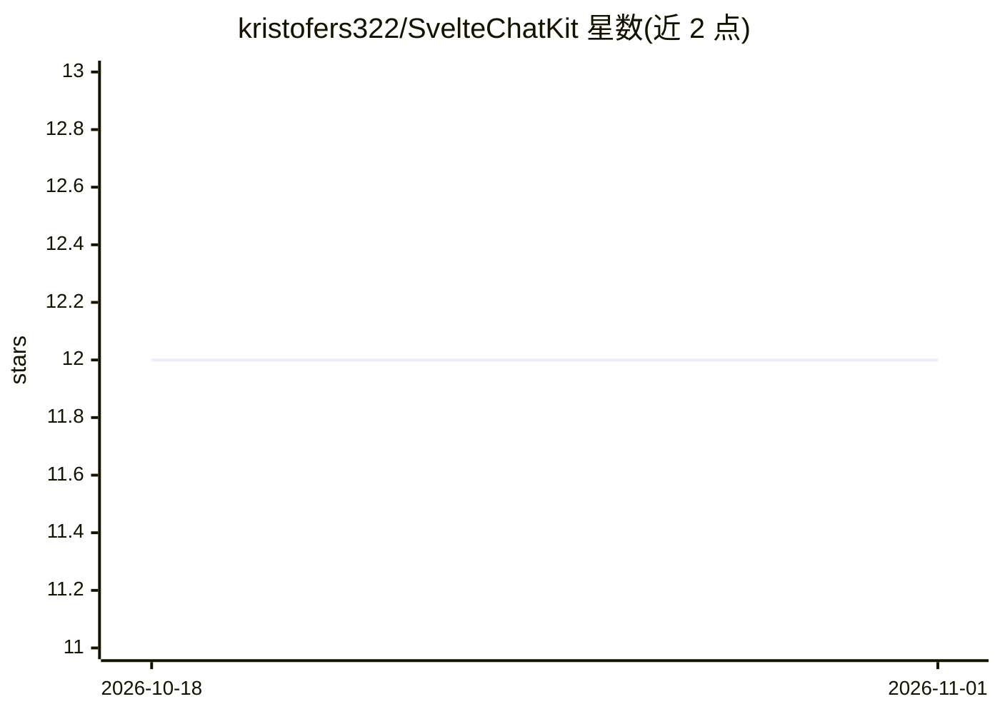

# kristofers322/SvelteChatKit

⭐ 12 · TypeScript · MIT · 推送 2026-07-07 · [GitHub](https://github.com/kristofers322/SvelteChatKit) · 个人维护

**SvelteKit 的 AI 聊天 UI 组件库，可切换任意 LLM 后端**

基于 Svelte 5 与 SvelteKit 2 的聊天 UI 库（TypeScript 严格模式，MIT）：提供 ChatProvider 接口，通过改配置对象即可在 OpenAI 兼容接口、Ollama、Dify、n8n、自定义端点与 mock 之间切换。内置逐 token 流式输出与中止按钮、localStorage 历史持久化、Markdown 代码高亮（经消毒）、文件/图片附件（2MB×4 上限，可配置）、深色模式与移动端适配。npm 安装后与 Tailwind v3/v4 搭配使用，零配置即以 mock provider 运行；需 Node 20+。自定义后端约 20 行代码实现接口并注册。

## 筛选速览

| 维度 | 判定 | 备注 |
|---|---|---|
| AI 角色 | `ai-ecosystem` | LLM/agent 周边工具 |
| 许可风险 | `permissive` | MIT |
| 部署形态 | `library` | 以包/库形式分发 |
| 模型依赖 | local-ok | 支持本地模型 |
| 硬件要求 | — | 无带数字的原话,不猜 |
| 安装摩擦 | `low` | 无编译、无系统依赖或容器化 |
| 成熟度 | — | 结构信号不足 |

## 能力要点

- 统一 ChatProvider 接口，配置对象切换 OpenAI/Ollama/Dify/n8n/自定义后端
- 逐 token 流式输出、可中止请求，localStorage 历史持久化
- Markdown 代码高亮（消毒）与多 provider 附件处理（vision/multipart/dataUrl）
- 零配置 mock provider 演示，无需 API key

## 适用场景

- 为自己的 SvelteKit 应用快速接入一个可换后端的 AI 聊天界面
- 在本地 Ollama 与 OpenAI 等服务之间切换而保持 UI 不变
- 用自定义接口对接 n8n 工作流或自有代理后端

## 场景标签

 · 领域:LLM 前端/组件库

## 证据(README 行号)

> L12: One chat UI, any LLM. Swap between OpenAI, Ollama, Dify, n8n or your own API by changing a config object. The strea
> L17: - One small `ChatProvider` interface. Your own backend takes about 20 lines

## 星数曲线

2026-10-18 12 → 2026-11-01 12（+0）

---
*卡片 v1 · prompt 1.4 · 生成 2026-11-01 · 置信度 high · 依据 README sha `fe3cf2416013` · [字段定义](../../DATASET.md)*
