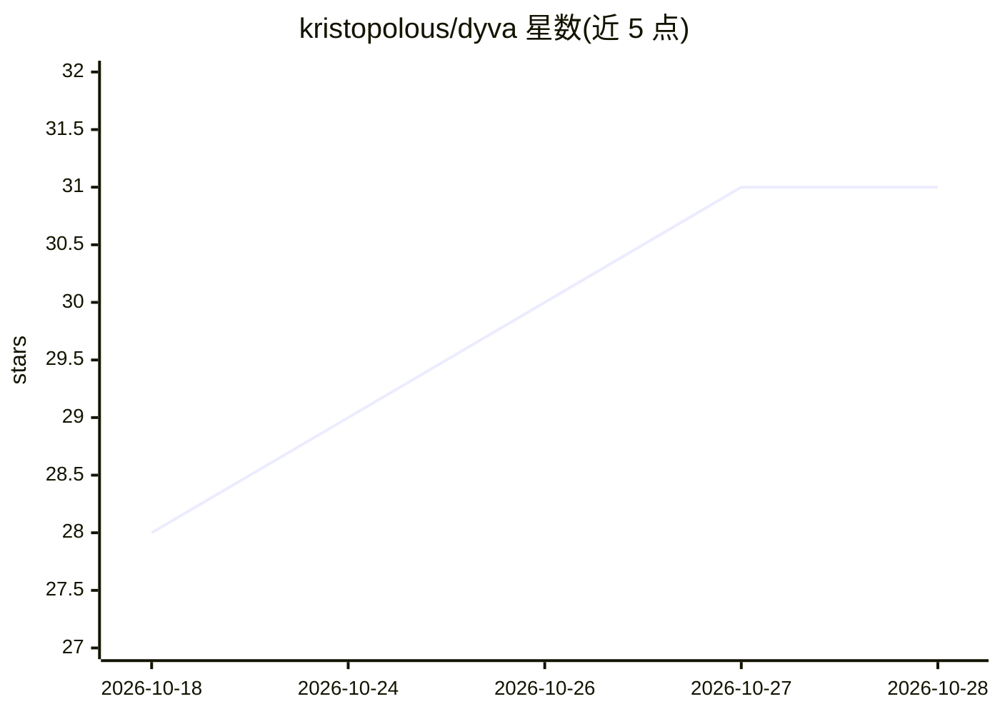

# kristopolous/dyva

⭐ 31 · Python · MIT · 推送 2026-10-27 · [GitHub](https://github.com/kristopolous/dyva) · 个人维护

**动态 AI 代理：将公网扫描到的模型主机聚合成统一路由池**

Dyva 是一个动态代理，从 Shodan、ZoomEye、Censys、hunter.how、FOFA 等来源获取 Ollama、vLLM、LM Studio、ComfyUI 等公开主机，组成模型池并以统一接口提供文本生成、嵌入、视觉、图像/视频/音乐生成、TTS 等能力，支持故障转移、上下文窗口缩放与蜜罐检测。提供模型查询语法按名称、大小、发布时间等条件切片路由池，并兼容 Ollama 客户端。通过 uvx 一行命令运行，内存占用低于 1GB；README 说明运行可能触发 CDN 蜜罐的临时封禁（约 4 天），可禁用公开扫描仅用自有主机列表。

## 筛选速览

| 维度 | 判定 | 备注 |
|---|---|---|
| AI 角色 | `ai-ecosystem` | LLM/agent 周边工具 |
| 许可风险 | `permissive` | MIT |
| 部署形态 | `None` |  |
| 模型依赖 | local-ok | 支持本地模型 |
| 硬件要求 | — | 无带数字的原话,不猜 |
| 安装摩擦 | `low` | 无编译、无系统依赖或容器化 |
| 成熟度 | — | 结构信号不足 |

## 能力要点

- 聚合 Shodan/ZoomEye/Censys/FOFA 等来源发现的多种本地推理与图像生成主机
- 模型查询语法按 glob、大小、发布日期、回退链切片路由池
- 兼容 Ollama 客户端 API，附带含聊天、图像生成、子代理、地理图等功能的前端
- 故障转移、上下文窗口缩放与蜜罐检测/隔离机制

## 适用场景

- 把散落公网的闲置 GPU 主机聚合成统一推理池使用
- 在任意应用中以查询语法指定模型池子集作为后端
- 用自有主机列表替代公开扫描，构建私有路由服务

## 场景标签

`模型网关` · 领域:Agent 开发

## 证据(README 行号)

> L6: **Dyva** is a dynamic proxy that routes to Ollama, vLLM, LM Studio, LocalAI, SGLang, KTransformers, MLX, llama.cpp, 
> L18: Along with being so ollama-compatible the ollama client doesn't know the difference, dyva has a feature-rich front-

## 星数曲线

2026-10-18 28 → 2026-10-28 31（+3）

---
*卡片 v1 · prompt 1.4 · 生成 2026-10-26 · 置信度 high · 依据 README sha `8b0fbc607cb9` · [字段定义](../../DATASET.md)*
