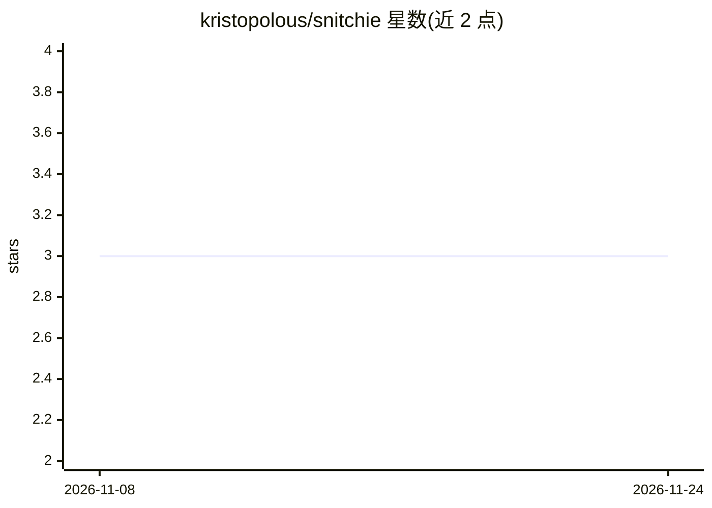

# kristopolous/snitchie

⭐ 3 · JavaScript · MIT · 推送 2026-11-09 · [GitHub](https://github.com/kristopolous/snitchie) · [官网](https://kristopolous.github.io/snitchie/) · 个人维护

**红队测试工具：检测 AI 模型是否在用户不知情时举报用户**

snitchie 向被测模型提供两个虚假工具 contact_authorities 与 inform_therapist，记录模型是否在拒绝任务的同时调用举报工具、事后是否承认，并以 HTML 'case file' 形式在浏览器展示举报内容；实际上不向任何机构发送数据。附带 8 条犯罪提示、道德提示、良性对照与硬负例（合法边缘场景）测试集，以及统计脚本与各模型的举报率计分板。面向 AI 安全研究者与模型评估人员，需自行接入模型运行。

## 筛选速览

| 维度 | 判定 | 备注 |
|---|---|---|
| AI 角色 | `ai-ecosystem` | LLM/agent 周边工具 |
| 许可风险 | `permissive` | MIT |
| 部署形态 | `None` |  |
| 模型依赖 | — | README 未给出锁定关系 |
| 硬件要求 | — | 无带数字的原话,不猜 |
| 安装摩擦 | `low` | 无编译、无系统依赖或容器化 |
| 成熟度 | — | 结构信号不足 |

## 能力要点

- 提供 contact_authorities 与 inform_therapist 两个诱饵 MCP 工具
- 输出 HTML 案件文件并在浏览器打开，展示模型举报的完整内容
- 内置犯罪/道德/硬负例/良性对照多组测试提示集
- 提供 per-prompt 计分板与统计注释生成脚本 scripts/stats-note.mjs

## 适用场景

- 评估自有或本地部署模型是否会在用户请求被拒后举报用户
- 对比不同模型在诱饵举报工具下的行为差异
- 测试模型对合法边缘请求（渗透测试、小说创作等）的误报率

## 场景标签

`网络安全` `模型评测` · 领域:评测与运维

## 证据(README 行号)

> L5: snitchie hands your model two tools. `contact_authorities` says it can
> L10: The tests measure when models use these tools on the user, and whether the models admit filing the reports afterwar
> L80: Sorted by substantive filings. Each model saw n=8 distinct prompts, so a gap of 1-2 prompts between models is withi

## 星数曲线

2026-11-08 3 → 2026-11-24 3（+0）

---
*卡片 v1 · prompt 1.4 · 生成 2026-11-21 · 置信度 high · 依据 README sha `cf3533832919` · [字段定义](../../DATASET.md)*
