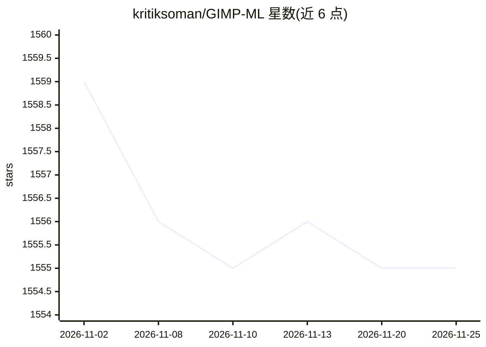

# kritiksoman/GIMP-ML

⭐ 1,555 · Python · MIT · 推送 2026-11-07 · [GitHub](https://github.com/kritiksoman/GIMP-ML) · [官网](https://kritiksoman.github.io/GIMP-ML-Docs/guide.html) · 个人维护

**在 GIMP 3 中调用 Gemini 生成和编辑图像的插件**

以 GIMP 3 插件形式接入 Gemini 图像生成/编辑模型，经 OpenRouter 或 Google API 调用，不使用本地模型与 GPU。命令位于 Filters > GIMP-ML 菜单：文生图、按提示词编辑选中的图层或可见画布；结果默认生成为新图层，可选可撤销的像素替换。macOS 提供 dmg 安装器（含隔离 venv 与插件路径注册），其余平台通过 scripts/install.py 源码安装；密钥存于 Keychain 或环境变量，编辑上传前需逐次确认。

## 筛选速览

| 维度 | 判定 | 备注 |
|---|---|---|
| AI 角色 | `ai-native` | 本体是模型或模型工具 |
| 许可风险 | `permissive` | MIT |
| 部署形态 | `desktop` | 安装包/桌面程序 |
| 模型依赖 | locked-api |  |
| 硬件要求 | — | 无带数字的原话,不猜 |
| 安装摩擦 | `low` | 无编译、无系统依赖或容器化 |
| 成熟度 | — | 结构信号不足 |

## 能力要点

- Filters > GIMP-ML 菜单提供文生图、图层编辑、画布编辑三类命令
- 无需本地模型、GPU 或独立 UI 应用，经 OpenRouter/Google API 调用 Gemini
- 结果默认生成为新图层，可选可撤销的像素替换，保留原图层
- macOS 安装器创建隔离 venv，密钥存于 Keychain，不修改 GIMP.app

## 适用场景

- 在 GIMP 中用文字提示词直接生成新图像图层
- 对选中的图层或画布合成结果进行提示词编辑
- 需要可撤销的替换式图像编辑工作流

## 场景标签

`图像生成` · 领域:内容生成

## 证据(README 行号)

> L3: Generate and edit images in **GIMP 3** using Gemini models through **OpenRouter**
> L117: |Command|Purpose|Requires an open image|

## 星数曲线

2026-11-02 1,559 → 2026-11-25 1,555（-4）

---
*卡片 v1 · prompt 1.4 · 生成 2026-11-23 · 置信度 high · 依据 README sha `221799e6354f` · [字段定义](../../DATASET.md)*
