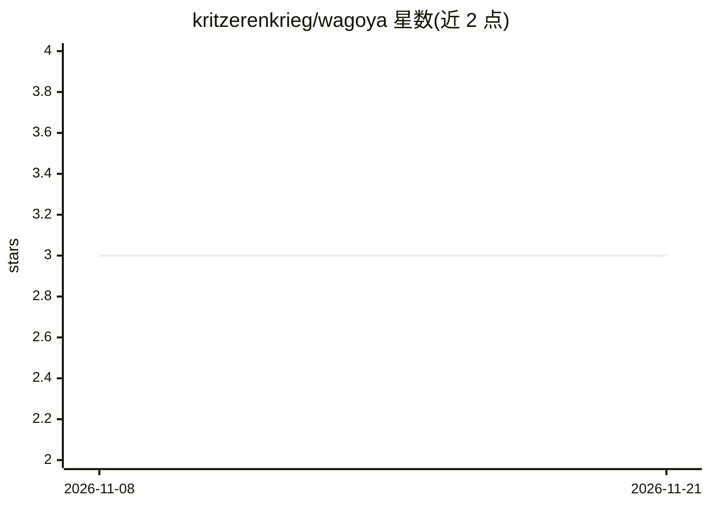

# kritzerenkrieg/wagoya

⭐ 3 · Go · 推送 2026-11-20 · [GitHub](https://github.com/kritzerenkrieg/wagoya) · 个人维护

**带人群长期记忆的 WhatsApp LLM 机器人（Go 编写）**

用 Go 编写的 WhatsApp 机器人，作为伴随设备通过 whatsmeow 接入 WhatsApp，以单个静态二进制运行（无 CGO，纯 Go SQLite）。支持私聊与群聊 @mention 触发，核心机制包括：按 WhatsApp 身份键控的全局人群画像库（SQLite FTS5 + 嵌入混合检索）、可编辑 persona、事实溯源与信任分级、提醒与任务管理、MCP 客户端与 http_request 工具、网页搜索、每日花费上限与限流。模型通过 anthropic/openrouter/openai 三类 provider 接入。

## 筛选速览

| 维度 | 判定 | 备注 |
|---|---|---|
| AI 角色 | `ai-native` | 本体是模型或模型工具 |
| 许可风险 | `none` | — |
| 部署形态 | `None` |  |
| 模型依赖 | locked-api |  |
| 硬件要求 | — | 无带数字的原话,不猜 |
| 安装摩擦 | `low` | 无编译、无系统依赖或容器化 |
| 成熟度 | — | 结构信号不足 |

## 能力要点

- 按 WhatsApp LID 键控的全局人群记忆，事实带来源与信任分级
- SQLite FTS5 + 嵌入的混合事实检索，按需搜索而非全量注入
- MCP 客户端与 http_request 工具，内置 SSRF 防护
- 通过 whatsmeow 以伴随设备方式接入 WhatsApp，静态二进制部署

## 适用场景

- 把自己的 WhatsApp 号变成一个有人设、记得住朋友的聊天机器人
- 在群聊中 @mention 机器人获取回答、搜索与提醒服务
- 为群成员维护画像与待办，到期自动 DM 提醒

## 场景标签

`聊天机器人` `AI 助手` `Agent 记忆` · 领域:Agent 开发

## 证据(README 行号)

> L5: **WhatsApp Go Assistant.** A WhatsApp number backed by an LLM, written in Go. DM it, or add it to group chats and @m
> L7: It runs as a single static binary (no CGO, pure-Go SQLite) and links to WhatsApp as a companion device through whats
> L69: |`anthropic` (default)|`ANTHROPIC_API_KEY`|`ANTHROPIC_MODEL`|Claude Messages API with tool loop, image input|

## 星数曲线

2026-11-08 3 → 2026-11-21 3（+0）

---
*卡片 v1 · prompt 1.4 · 生成 2026-11-21 · 置信度 high · 依据 README sha `45ad51a6a333` · [字段定义](../../DATASET.md)*
