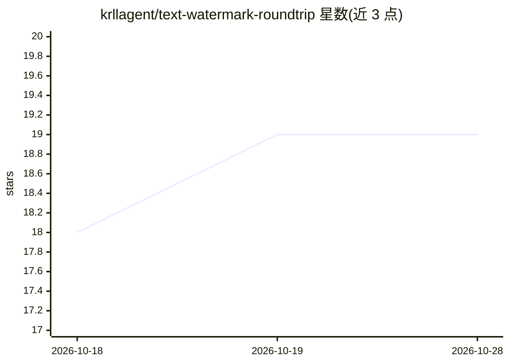

# krllagent/text-watermark-roundtrip

⭐ 19 · Python · MIT · 推送 2026-09-09 · [GitHub](https://github.com/krllagent/text-watermark-roundtrip) · [官网](https://painintheagent.com/tools/ai-text-watermark-remover/) · 个人维护

**SynthID 文本水印去除实验：复现 paraphrase/翻译/改写的效果对比**

一个完整记录的水印实验仓库：在 10 篇带 SynthID 水印的英文报告及其干净孪生文本上，测试 LLM paraphrase、DIPPER-11B、轻量同义词替换、德语与中文往返翻译五种改写方法对水印信号的去除率与事实保留率。检测基于固定采样表的平均 g 值与预校准阈值（纯 CPU），盲评事实面板使用四家模型评审并含金丝雀校验。总成本约 1.45 美元，所有产物保留 sha256 与生命周期记录，单元测试可在无 GPU 环境复现最终表格。限制：语料仅 10 篇 480-639 词文本，单一 key 与语料，未验证私有 Claude/Gemini key。

## 筛选速览

| 维度 | 判定 | 备注 |
|---|---|---|
| AI 角色 | `ai-knowledge` | 知识聚合/清单类 |
| 许可风险 | `permissive` | MIT |
| 部署形态 | `library` | 以包/库形式分发 |
| 模型依赖 | — | README 未给出锁定关系 |
| 硬件要求 | — | 无带数字的原话,不猜 |
| 安装摩擦 | `low` | 无编译、无系统依赖或容器化 |
| 成熟度 | — | 结构信号不足 |

## 能力要点

- 五种改写方法（paraphrase/DIPPER/同义词/德中往返翻译）的水印去除与事实保留对比
- CPU 可复现：阈值校准与评估无需 GPU，付费阶段约 $1.45
- 盲评四模型事实面板 + 金丝雀机制淘汰异常评审
- RunPod GPU 任务带预算冻结、检查点与自动清理看门狗

## 适用场景

- 复现或核验 SynthID 文本水印的去除率表格
- 研究 paraphrase 攻击对 AI 文本水印的影响
- 参考低成本可复现实验与多模型评审面板的工程做法

## 场景标签

`科研工具` · 领域:学习与行业

## 证据(README 行号)

> L3: Does a full paraphrase remove Google DeepMind's **SynthID Text** watermark, and
> L5: Pain in the Agent article on text-watermark removal
> L54: |Stage|Script|Where it ran|Cost|

## 星数曲线

2026-10-18 18 → 2026-10-28 19（+1）

---
*卡片 v1 · prompt 1.4 · 生成 2026-10-28 · 置信度 high · 依据 README sha `4810d3dadbbb` · [字段定义](../../DATASET.md)*
