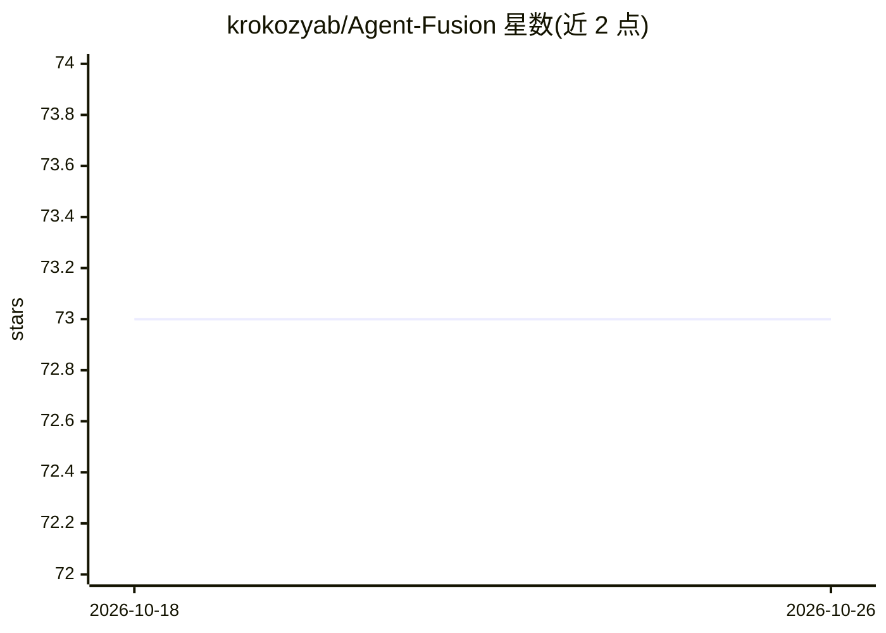

# krokozyab/Agent-Fusion

⭐ 73 · Kotlin · MIT · 推送 2026-06-20 · [GitHub](https://github.com/krokozyab/Agent-Fusion) · 个人维护

**本地 RAG 语义搜索 MCP 服务器，供多个 AI 编码助手检索代码与文档**

面向 AI 编码助手的 MCP 工具，含两个可独立使用的组件：Context Engine 将代码、Markdown、Word、PDF 切块并嵌入索引，通过 query_context 提供语义、符号、全文三路并行检索，结果带层级关系（父/子/兄弟/前后块）可做图谱遍历；文件监视器自动重建索引，数据存于本地 DuckDB。Task Manager 可选，负责任务路由、多 AI 投票决策与 Web 看板。部署为单个 JAR 加 TOML 配置，需 Java，无外部 API 或云依赖，内含轻量嵌入模型且可替换。

## 筛选速览

| 维度 | 判定 | 备注 |
|---|---|---|
| AI 角色 | `ai-ecosystem` | LLM/agent 周边工具 |
| 许可风险 | `permissive` | MIT |
| 部署形态 | `None` |  |
| 模型依赖 | — | README 未给出锁定关系 |
| 硬件要求 | — | 无带数字的原话,不猜 |
| 安装摩擦 | `low` | 无编译、无系统依赖或容器化 |
| 成熟度 | — | 结构信号不足 |

## 能力要点

- 语义/符号/全文三路并行检索并按相关性排序
- 块 ID 编码层级关系，支持语义搜索后遍历知识图谱
- 文件监视器自动重新索引，索引存于本地 DuckDB
- 多 AI 任务路由、投票共识与 Web 看板（可选组件）

## 适用场景

- 让编码 agent 语义检索代码库，替代纯 grep 匹配
- 跨代码、PDF、Word、Markdown 统一语义搜索
- 多个 AI 助手协作决策并保留推理审计记录

## 场景标签

`RAG` `语义搜索` · 领域:知识与检索

## 证据(README 行号)

> L5: Agent Fusion MCP tool gives multiple AI coding assistants instant access to your files—code, documents, PDFs, and mo
> L8: - **MCP Context Engine: RAG for Code & Documents** – Local semantic search and graph traversal for AI agents. Indexe
> L83: - **Agent Access**: Tell your AI agents "use query_context to find X" and they'll search instantly

## 星数曲线

2026-10-18 73 → 2026-10-26 73（+0）

---
*卡片 v1 · prompt 1.4 · 生成 2026-10-24 · 置信度 high · 依据 README sha `dfc89328823e` · [字段定义](../../DATASET.md)*
