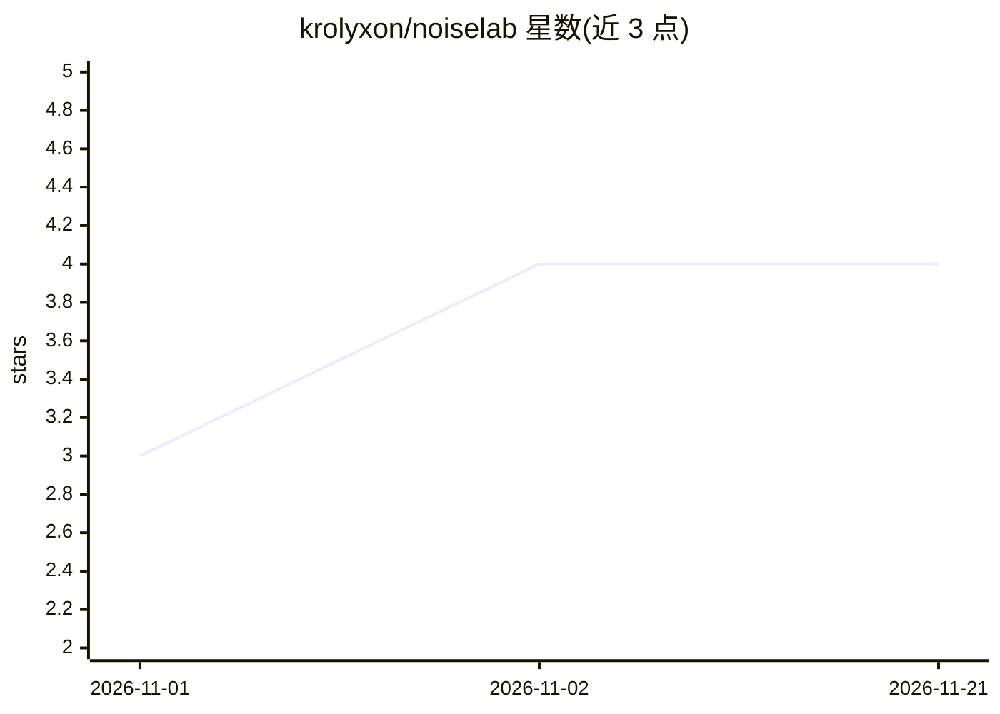

# krolyxon/noiselab

⭐ 4 · Python · GPL-3.0 · 推送 2026-10-30 · [GitHub](https://github.com/krolyxon/noiselab) · 个人维护

**比较 11 种语音降噪算法的基准研究、Simulink 模型与交互式 Web 应用**

将 11 种单通道语音增强算法（手写谱减法与统计估计器、Simulink 模型实现、六个第三方基线如 DeepFilterNet3 与 Demucs）纳入同一流水线，在 LibriSpeech 语音与多种噪声、六个 SNR 条件下共 14,520 次运行，用 ΔSI-SDR、ΔPESQ、RTF 等指标统一评测。提供 Flask Web 应用录制/上传音频、实时调参、查看频谱图与逐帧 STFT，并支持一键多算法对比；基准脚本确定性可复现。神经模型需另建 PyTorch 环境且 NumPy<2。

## 筛选速览

| 维度 | 判定 | 备注 |
|---|---|---|
| AI 角色 | `ai-native` | 本体是模型或模型工具 |
| 许可风险 | `viral` | GPL-3.0 |
| 部署形态 | `library` | 以包/库形式分发 |
| 模型依赖 | — | README 未给出锁定关系 |
| 硬件要求 | — | 无带数字的原话,不猜 |
| 安装摩擦 | `low` | 无编译、无系统依赖或容器化 |
| 成熟度 | — | 结构信号不足 |

## 能力要点

- 11 种算法同一流水线、同一指标、14,520 次运行的统一基准
- 从零搭建的 Simulink 谱减法模型，与 NumPy 实现逐位对齐校验
- Flask Web 应用支持实时调参、频谱/增益掩码/STFT 帧检查器与 A/B 试听
- 基准确定性、可续跑，脚本一键复现表格与图表

## 适用场景

- 为语音降噪任务按噪声类型和算力预算挑选算法
- 教学或课程项目中对照研究经典 DSP 与神经网络方法
- 用自己的音频片段在浏览器中对比多种降噪效果
- 复现语音增强基准实验并生成统计报告

## 场景标签

`模型评测` · 领域:评测与运维

## 证据(README 行号)

> L5: NoiseLab compares 11 single-channel speech-enhancement algorithms, from classical spectral subtraction to deep neura
> L10: - **An interactive web app** to record or upload audio, tune every parameter live, look inside the algorithm (spect

## 星数曲线

2026-11-01 3 → 2026-11-21 4（+1）

---
*卡片 v1 · prompt 1.4 · 生成 2026-11-21 · 置信度 high · 依据 README sha `6811e6120f9c` · [字段定义](../../DATASET.md)*
