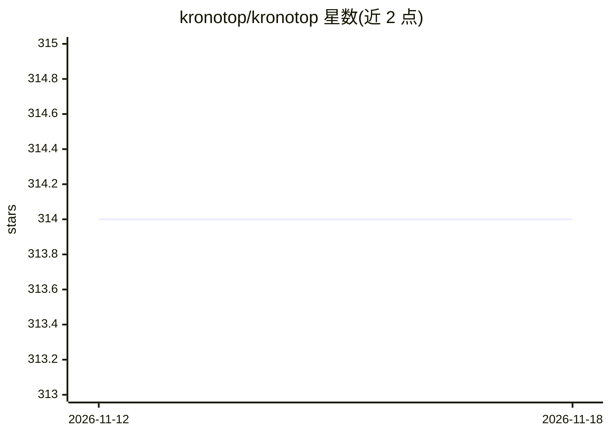

# kronotop/kronotop

⭐ 314 · Java · Apache-2.0 · 推送 2026-11-17 · [GitHub](https://github.com/kronotop/kronotop) · [官网](https://kronotop.com) · 组织维护

**基于 FoundationDB 的分布式事务文档数据库，支持向量检索**

以 FoundationDB 为存储后端的分布式多模型数据库：Bucket 文档模型（BSON、BQL 查询语言、二级/复合/向量索引、规则式查询规划器）与 ZMap 有序键值模型可参与同一 ACID 事务；namespace 提供键空间级租户隔离，单集群可创建百万级逻辑库。支持 RESP2/RESP3 协议，可复用 redis-cli/valkey-cli。向量检索基于 JVector 的 HNSW 索引，可用作 AI agent 记忆存储。目前处于 developer preview，运行需 Java 25+，提供 Docker Compose 快速启动与预编译 jar。

## 筛选速览

| 维度 | 判定 | 备注 |
|---|---|---|
| AI 角色 | `ai-ecosystem` | LLM/agent 周边工具 |
| 许可风险 | `permissive` | Apache-2.0 |
| 部署形态 | `desktop` | 安装包/桌面程序 |
| 模型依赖 | — | README 未给出锁定关系 |
| 硬件要求 | — | 无带数字的原话,不猜 |
| 安装摩擦 | `low` | 无编译、无系统依赖或容器化 |
| 成熟度 | `idea` | |

## 能力要点

- Bucket 文档模型支持 BQL 查询、二级/复合/向量索引与规则式查询规划器
- 严格可串行化事务，Bucket 与 ZMap 可参与同一 ACID 事务
- namespace 级租户隔离，单集群曾创建 1,000,001 个逻辑库
- 基于 JVector 的 HNSW ANN 向量检索，支持 cosine/euclidean/dot_product

## 适用场景

- 为 AI agent 提供带事务更新的记忆与向量检索存储
- 需要水平扩展的严格事务文档存储
- 多租户场景下按 namespace 隔离各租户/应用数据

## 场景标签

`向量数据库` `Agent 记忆` · 领域:Agent 开发

## 证据(README 行号)

> L5: Kronotop is a distributed, transactional document database backed
> L44: The same model fits an AI agent: a namespace per agent holds its memory, vector search runs over those documents,
> L352: Bucket supports approximate nearest neighbor (ANN) search on document vector fields, powered

## 星数曲线

2026-11-12 314 → 2026-11-18 314（+0）

---
*卡片 v1 · prompt 1.4 · 生成 2026-11-17 · 置信度 high · 依据 README sha `ea873d3fb33c` · [字段定义](../../DATASET.md)*
