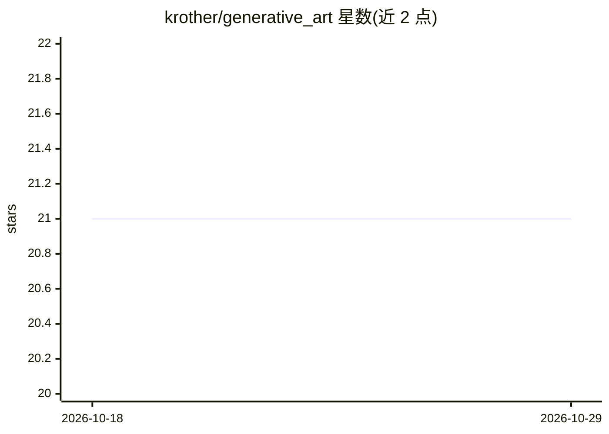

# krother/generative_art

⭐ 21 · Jupyter Notebook · MIT · 推送 2026-03-01 · [GitHub](https://github.com/krother/generative_art) · 个人维护

**用 Python 与 NumPy 生成图像的入门教程与练习集**

面向已入门 Python 的学习者的 NumPy 图像绘制教程：通过示例与挑战练习创建灰度/彩色图像、几何图形、滤镜效果、递归图形（龙形曲线、Mandelbrot）与动画。包含少量机器学习章节（K-Means 聚类、决策树颜色预测、卷积核、蒙特卡洛采样）。安装方式为 git clone 后 pip install -r requirements.txt，Anaconda 用户自带所需库。整体定位是教学练习，而非可复用的库或工具。

## 筛选速览

| 维度 | 判定 | 备注 |
|---|---|---|
| AI 角色 | `ai-knowledge` | 知识聚合/清单类 |
| 许可风险 | `permissive` | MIT |
| 部署形态 | `library` | 以包/库形式分发 |
| 模型依赖 | — | README 未给出锁定关系 |
| 硬件要求 | — | 无带数字的原话,不猜 |
| 安装摩擦 | `low` | 无编译、无系统依赖或容器化 |
| 成熟度 | — | 结构信号不足 |

## 能力要点

- 按主题组织的示例与挑战练习（索引、切片、矩阵运算等）
- 涵盖几何、滤镜效果、递归图形与动画等图像生成练习
- 含 K-Means、决策树、卷积核、蒙特卡洛等机器学习章节

## 适用场景

- 边学边练 NumPy 数组操作与图像处理
- Python 教学课程的可视化练习材料
- 了解如何用基础算法生成艺术图像

## 场景标签

`教程课程` · 领域:学习与行业

## 证据(README 行号)

> L3: In this tutorial you find NumPy exercises that create images.
> L7: It is meant as a gentle introduction to NumPy.

## 星数曲线

2026-10-18 21 → 2026-10-29 21（+0）

---
*卡片 v1 · prompt 1.4 · 生成 2026-10-28 · 置信度 high · 依据 README sha `f12707d76e92` · [字段定义](../../DATASET.md)*
