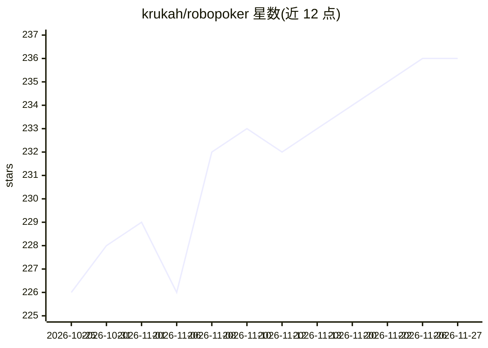

# krukah/robopoker

⭐ 236 · Rust · MIT · 推送 2026-10-28 · [GitHub](https://github.com/krukah/robopoker) · [官网](https://robopoker.io) · 个人维护

**Rust 编写的超人类规模扑克 AI 求解库**

以 Rust 从零实现的 No-Limit Hold'em 求解库，覆盖抽象、训练、实时搜索三阶段流程：分层 k-means 手牌抽象（EMD 距离）、可插拔的 MCCFR 训练框架、深度受限与多世界安全再求解，另有 Deep CFR 网络路径与 AIVAT 方差缩减。由十余个 crates.io 发布的 crate 组成，训练依赖 PostgreSQL，提供 Slumbot 实战评估与 litmus 战略测试套件。面向扑克 AI 研究与博弈论求解实现者。

## 筛选速览

| 维度 | 判定 | 备注 |
|---|---|---|
| AI 角色 | `ai-native` | 本体是模型或模型工具 |
| 许可风险 | `permissive` | MIT |
| 部署形态 | `library` | 以包/库形式分发 |
| 模型依赖 | — | README 未给出锁定关系 |
| 硬件要求 | — | 无带数字的原话,不猜 |
| 安装摩擦 | `low` | 无编译、无系统依赖或容器化 |
| 成熟度 | — | 结构信号不足 |

## 能力要点

- 游戏无关的 MCCFR 框架，可插拔 regret/policy/sampling
- 分层 k-means 抽象：EMD 距离、k-means++ 播种、Elkan 加速
- Deep CFR 网络（RegretNet/StrategyNet），Kuhn/RPS 可编译为 WebAssembly 在浏览器训练
- 10,000 手 Pluribus 牌局逐决策回放与 Slumbot 86K 手实盘评估

## 适用场景

- 训练和评估 NLHE 蓝图策略并做实时再求解
- 在 Kuhn/Leduc/RPS 等小型博弈上验证 CFR 实现
- 对牌局历史做 AIVAT 低方差评估与回放分析

## 场景标签

`强化学习` · 领域:训练与推理

## 证据(README 行号)

> L8: Superhuman-scale poker AI written from scratch in Rust, seeking functional parity with Pluribus¹ and paying homage t
> L22: |**Generic MCCFR framework**|Pluggable regret/policy/sampling, held to closed-form equilibria on Kuhn, Leduc, RPS|
> L35: An abstraction computed once, a blueprint trained against it — by tables or by networks — and a re-solve at play ti

## 星数曲线

2026-10-25 226 → 2026-11-27 236（+10）

---
*卡片 v1 · prompt 1.4 · 生成 2026-11-25 · 置信度 high · 依据 README sha `9da77e3426d7` · [字段定义](../../DATASET.md)*
