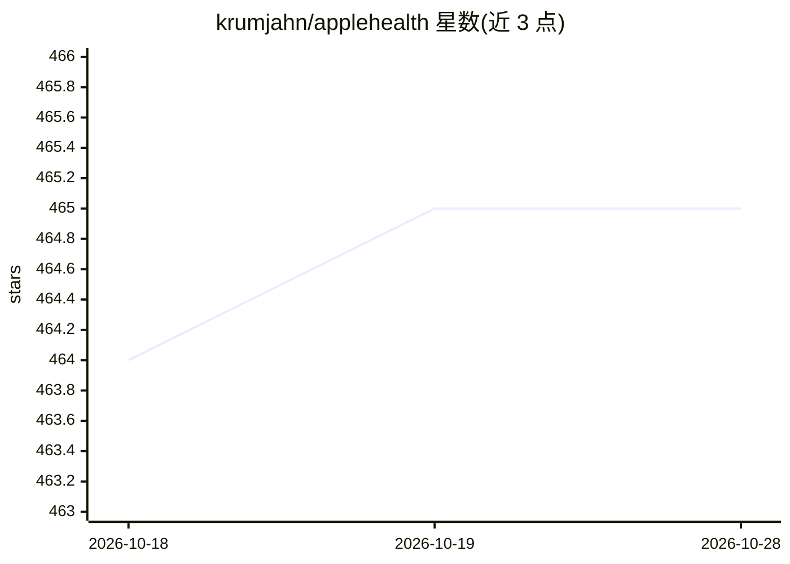

# krumjahn/applehealth

⭐ 465 · Python · 推送 2026-10-25 · [GitHub](https://github.com/krumjahn/applehealth) · [官网](https://applehealthdata.com) · 个人维护

**与 Apple Health 导出数据对话的终端 AI 分析器**

Python CLI 工具（3.9+），读取 Apple Health 的 export.xml，转换为 CSV/JSON 并提供聊天式问答界面：用户用自然语言查询步数、心率、睡眠、锻炼等指标，工具生成查询感知的本地摘要供 LLM 回答，并可自动生成图表。支持 50+ 模型（GPT-4o、Claude、Gemini、DeepSeek-R1 等），也可经 Ollama、Jan、LM Studio、llama.cpp、GPT4All 或任意 OpenAI 兼容端点完全本地运行。内含多来源数据调和与单位归一化策略，另发布 OpenClaw 技能。面向开发者、生物黑客与研究人员。

## 筛选速览

| 维度 | 判定 | 备注 |
|---|---|---|
| AI 角色 | `ai-native` | 本体是模型或模型工具 |
| 许可风险 | `none` | — |
| 部署形态 | `self-host` | docker 或自建部署 |
| 模型依赖 | local-ok | 支持本地模型 |
| 硬件要求 | — | 无带数字的原话,不猜 |
| 安装摩擦 | `low` | 无编译、无系统依赖或容器化 |
| 成熟度 | — | 结构信号不足 |

## 能力要点

- export.xml → CSV/JSON 导出，保留 Record/Workout/ActivitySummary 元数据
- 聊天 REPL + 斜杠命令（/steps、/sleep、/workouts 等）查询与自动图表
- 多来源重叠数据调和与优先级设置，单位统一归一化
- 支持 Ollama 等 5 种本地运行时及任意 OpenAI 兼容端点的 100% 私有模式

## 适用场景

- 在终端里用自然语言查询自己多年的 Apple Health 数据
- 本地 LLM 离线分析健康数据，数据不出本机
- 整合 Oura/Whoop/三星戒指经 Apple Health 同步的数据
- 让 AI Agent（OpenClaw 等）生成每日健康简报

## 场景标签

`数据分析` · 领域:效率与自动化

## 证据(README 行号)

> L3: **A terminal AI assistant for your Apple Health data. Chat with 8 years of personal health metrics using any LLM — l
> L39: A purpose-built CLI that turns your Apple Health `export.xml` into a conversational AI session. Think of it as havi
> L45: - 🧠 **50+ AI Models**: GPT-4o, Claude, Gemini, DeepSeek-R1, Grok, Mistral, Llama, and any Ollama local model.

## 星数曲线

2026-10-18 464 → 2026-10-28 465（+1）

---
*卡片 v1 · prompt 1.4 · 生成 2026-10-21 · 置信度 high · 依据 README sha `27d1b900df4d` · [字段定义](../../DATASET.md)*
