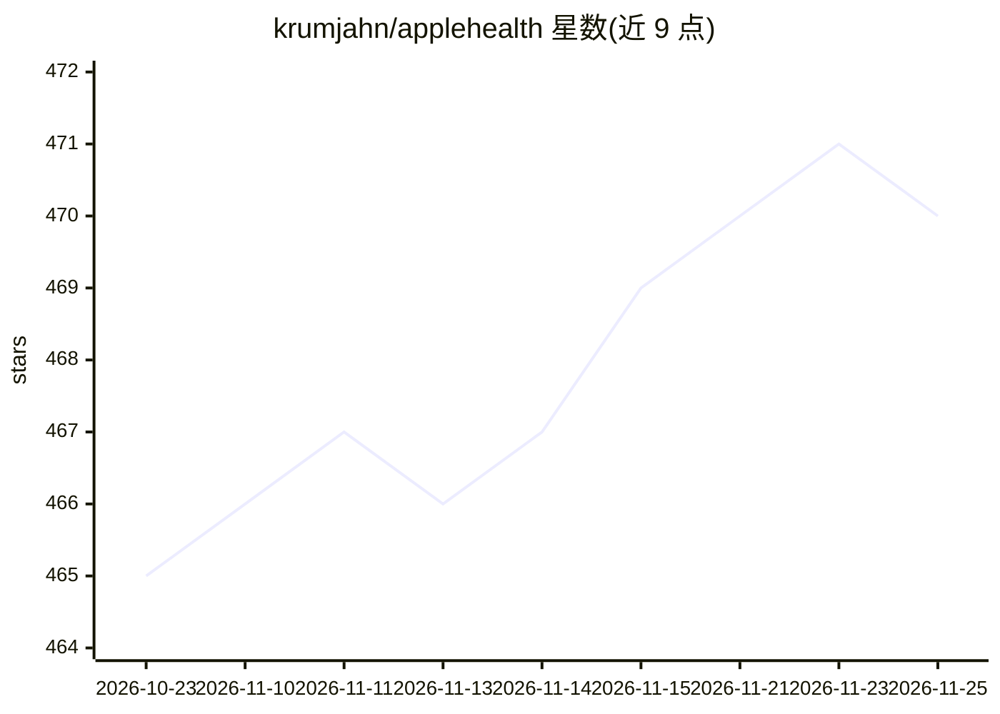

# krumjahn/applehealth

⭐ 470 · Python · 推送 2026-11-11 · [GitHub](https://github.com/krumjahn/applehealth) · [官网](https://applehealthdata.com) · 个人维护

**面向开发者的 Apple Health 本地导出分析工具，含可选 AI 问答**

本地运行的 Apple Health 导出数据处理工具集：convert 命令将 XML/ZIP 导出流式转换为 CSV/JSON 并保留嵌套锻炼详情；dashboard 命令生成单文件离线 HTML 月度报告，含步数、睡眠、静息心率、HRV、锻炼图表与覆盖率统计。转换与仪表盘全程无网络请求、无需 API key。AI 问答为可选路径：设置向导配置模型后以聊天 REPL 形式构建查询感知的本地摘要。目标用户为开发者、biohacker 与研究者。

## 筛选速览

| 维度 | 判定 | 备注 |
|---|---|---|
| AI 角色 | `ai-enhanced` | 去掉 AI 部分产品仍成立 |
| 许可风险 | `none` | — |
| 部署形态 | `desktop` | 安装包/桌面程序 |
| 模型依赖 | local-ok | 支持本地模型 |
| 硬件要求 | — | 无带数字的原话,不猜 |
| 安装摩擦 | `low` | 无编译、无系统依赖或容器化 |
| 成熟度 | — | 结构信号不足 |

## 能力要点

- XML/ZIP 流式转换，百万行级峰值内存约 26 MiB
- 单文件离线 HTML 仪表盘，4 种模板可切换
- 可选 AI 聊天 REPL，支持 GPT-4o、Claude、Gemini、DeepSeek-R1、Ollama 本地模型等 50+
- 转换与仪表盘生成无网络请求与遥测

## 适用场景

- 把 iPhone 健康导出转成可用的 CSV/JSON 做自己的分析
- 离线生成月度健康报告与趋势图表
- 用本地模型私密地问健康数据问题

## 场景标签

`数据分析` · 领域:效率与自动化

## 证据(README 行号)

> L3: **Turn your Apple Health export into a private dashboard, usable CSV/JSON, or an optional AI conversation. Your dash
> L67: **Privacy:** dashboard generation makes no network requests. The HTML contains your health summaries and source nam
> L163: A local Apple Health data toolkit: convert an XML/ZIP export into usable files, then explore trends with charts or

## 星数曲线

2026-10-23 465 → 2026-11-25 470（+5）

---
*卡片 v1 · prompt 1.4 · 生成 2026-11-25 · 置信度 mid · 依据 README sha `45cbad986673` · [字段定义](../../DATASET.md)*
