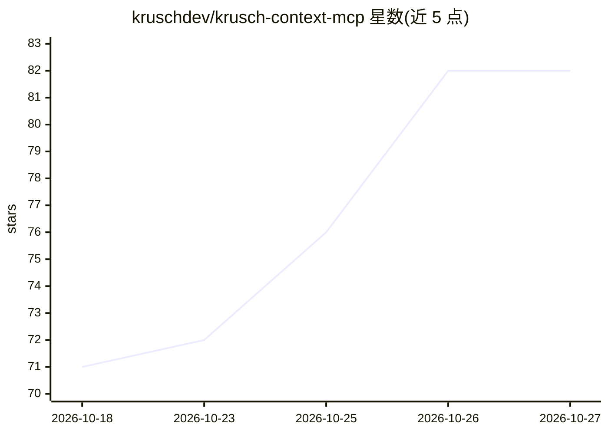

# kruschdev/krusch-context-mcp

⭐ 82 · JavaScript · MIT · 推送 2026-10-26 · [GitHub](https://github.com/kruschdev/krusch-context-mcp) · 个人维护

**给 AI 编码代理的持久化项目记忆 MCP 服务器**

面向 Cursor、Claude Code、Windsurf 等 AI 编码代理的本地 MCP 服务器：通过 5 个标准化动词（retrieve/remember/revise/nudge/health）跨会话存取架构决策、不变量、缺陷诊断等项目知识；写入采用封闭分类与近重复检测（相似度≥0.85 提示替代），事实被替代时保留时间谱系，nudge 可作为 pre-commit 审计器将 diff 与活跃约束比对。默认 SQLite 存储、零 Docker，嵌入默认离线关键词模式，可选 Ollama 或 OpenRouter 云端嵌入；PostgreSQL 仅在多机多代理集中持久化时需要。需 Node.js ≥22。

## 筛选速览

| 维度 | 判定 | 备注 |
|---|---|---|
| AI 角色 | `ai-ecosystem` | LLM/agent 周边工具 |
| 许可风险 | `permissive` | MIT |
| 部署形态 | `library` | 以包/库形式分发 |
| 模型依赖 | local-ok | 支持本地模型 |
| 硬件要求 | — | 无带数字的原话,不猜 |
| 安装摩擦 | `low` | 无编译、无系统依赖或容器化 |
| 成熟度 | — | 结构信号不足 |

## 能力要点

- 严格 5 个 MCP 动词，约 350 prompt tokens
- 封闭分类写入（decision/invariant/bug/lesson/blocker）与近重复检测
- supersede/invalidate 带时间谱系与强制失效原因
- span 溯源（anchor_hash）与代码漂移自愈/标记 [DRIFTED]

## 适用场景

- 让编码代理跨会话记住架构决策与项目规则
- 提交前用 nudge 审计 diff 是否违反项目不变量
- 替代并追溯过时事实，避免记忆冲突污染

## 场景标签

`Agent 记忆` · 领域:Agent 开发

## 证据(README 行号)

> L16: **Krusch Context MCP** gives AI coding agents (Cursor, Claude Code, Windsurf, Antigravity) persistent working memor
> L42: Krusch Context MCP exposes strictly **5 canonical verbs** designed to fit into standard coding workflows:

## 星数曲线

2026-10-18 71 → 2026-10-27 82（+11）

---
*卡片 v1 · prompt 1.4 · 生成 2026-10-24 · 置信度 high · 依据 README sha `8e2e0ec19c0a` · [字段定义](../../DATASET.md)*
