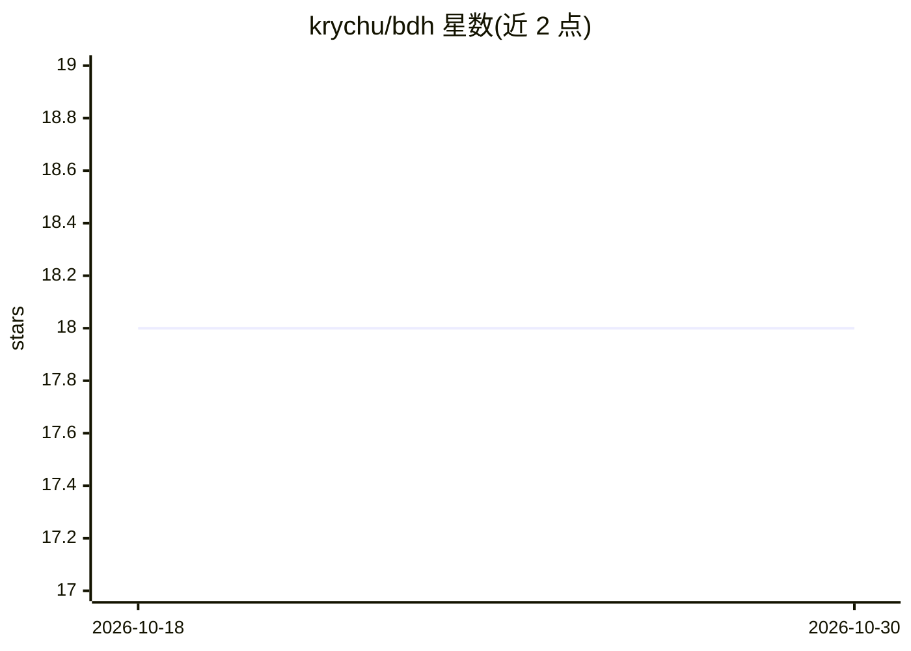

# krychu/bdh

⭐ 18 · Python · 推送 2025-12-04 · [GitHub](https://github.com/krychu/bdh) · 个人维护

**BDH 论文的 PyTorch 教学实现：寻路任务演示与推理可视化**

对 arXiv 2025 论文《The Dragon Hatchling》提出的 BDH-GPU 架构的第三方教学性 PyTorch 实现。在带障碍的 N×N 棋盘寻路任务上训练与推理模型，并生成神经元动力学、注意力稀疏性等可视化 GIF。实现涵盖论文的核心机制：神经元维度扩展、因果电路 Gx 与输出电路 Gy、基于赫布学习的边重加权动态状态、正稀疏激活。通过 boardpath.py 命令行运行，配置需修改源码中的 get_config() 函数。

## 筛选速览

| 维度 | 判定 | 备注 |
|---|---|---|
| AI 角色 | `ai-native` | 本体是模型或模型工具 |
| 许可风险 | `none` | — |
| 部署形态 | `library` | 以包/库形式分发 |
| 模型依赖 | — | README 未给出锁定关系 |
| 硬件要求 | — | 无带数字的原话,不猜 |
| 安装摩擦 | `low` | 无编译、无系统依赖或容器化 |
| 成熟度 | — | 结构信号不足 |

## 能力要点

- 论文 BDH 架构的 PyTorch 实现，含训练与推理 CLI（boardpath.py）
- 因果电路与输出电路（Gx/Gy）及赫布学习边重加权机制
- 推理过程可视化：棋盘预测、神经元动力学、注意力稀疏动画
- 支持固定随机种子复现训练

## 适用场景

- 通过可运行的寻路任务理解 BDH 架构的机制
- 可视化观察模型内部因果电路与稀疏激活
- 复现论文中涌现的稀疏模块化组织现象

## 场景标签

`教程课程` · 领域:学习与行业

## 证据(README 行号)

> L3: This repository contains an educational PyTorch implementation of the BDH-GPU architecture proposed in the paper:
> L14: The model is trained on a pathfinding task: given an N×N board with obstacles, find the shortest path from START to

## 星数曲线

2026-10-18 18 → 2026-10-30 18（+0）

---
*卡片 v1 · prompt 1.4 · 生成 2026-10-29 · 置信度 mid · 依据 README sha `634380bb7f12` · [字段定义](../../DATASET.md)*
