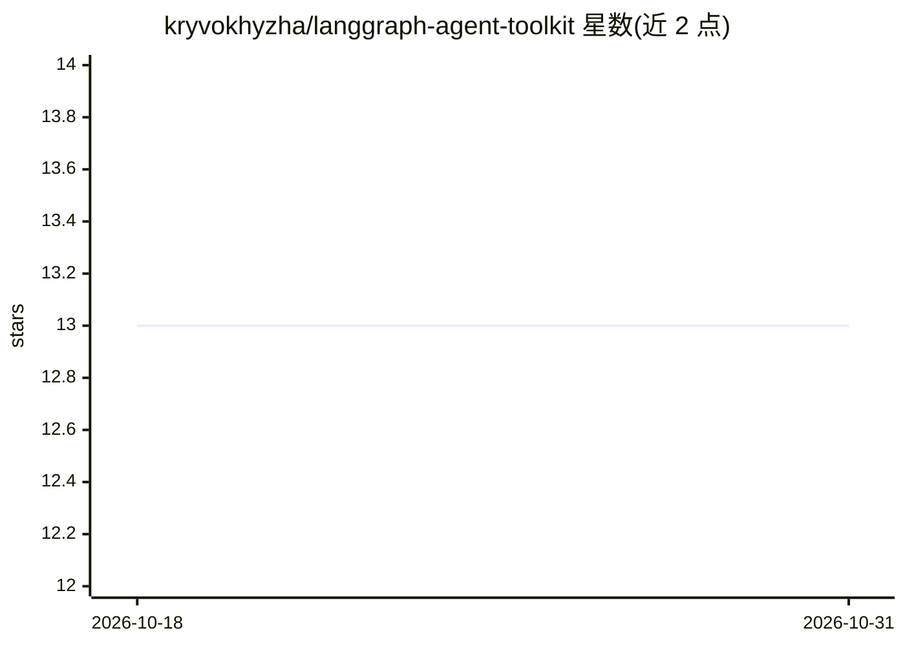

# kryvokhyzha/langgraph-agent-toolkit

⭐ 13 · Python · MIT · 推送 2026-10-29 · [GitHub](https://github.com/kryvokhyzha/langgraph-agent-toolkit) · [官网](https://kryvokhyzha.github.io/langgraph-agent-toolkit) · 个人维护

**通过 FastAPI 认证接口部署 LangGraph agent 的工具包**

以 LangGraph、FastAPI 和 Streamlit 构建的工具包，将 agent 通过带认证的 HTTP API 对外提供服务：提供调用、SSE、JSON Lines 流式路由，同步/异步 AgentClient，SQLite 或 PostgreSQL 检查点与按用户区分的会话历史，支持多提供商 LLM 连接管理、可选 MCP 工具、Deep Agents 及 Langfuse/LangSmith/Phoenix 可观测性集成。面向在自己应用中部署会话式 AI agent 的开发者。按 extras 安装所需集成，提供 Docker 镜像（含 Uvicorn/Gunicorn 运行）；不提供持久任务或 exactly-once 工具写入。

## 筛选速览

| 维度 | 判定 | 备注 |
|---|---|---|
| AI 角色 | `ai-ecosystem` | LLM/agent 周边工具 |
| 许可风险 | `permissive` | MIT |
| 部署形态 | `self-host` | docker 或自建部署 |
| 模型依赖 | — | README 未给出锁定关系 |
| 硬件要求 | — | 无带数字的原话,不猜 |
| 安装摩擦 | `low` | 无编译、无系统依赖或容器化 |
| 成熟度 | — | 结构信号不足 |

## 能力要点

- 带认证的 FastAPI 路由：调用、SSE、JSON Lines、会话列表与历史分页
- SQLite/PostgreSQL 检查点，按用户/agent/线程隔离会话存储
- 模型工厂带连接复用、超时、有界重试与可选 aiohttp 传输（OpenAI/Azure）
- 可选 MCP 工具、Deep Agents、LLM 工具选择与 Langfuse/LangSmith/Phoenix 集成

## 适用场景

- 为 LangGraph/LangChain agent 构建可部署的 HTTP 服务
- 在自己应用中接入带流式输出与会话记忆的对话 agent
- 为生产部署配置认证、持久化与可观测性

## 场景标签

`Agent 框架` · 领域:Agent 开发

## 证据(README 行号)

> L9: Serve LangGraph agents through an authenticated HTTP API. Add streaming,
> L28: - FastAPI routes for invocation, SSE, JSON Lines, conversation lists, history,
> L42: Install only the integrations that your service needs. LiteLLM, Langfuse,

## 星数曲线

2026-10-18 13 → 2026-10-31 13（+0）

---
*卡片 v1 · prompt 1.4 · 生成 2026-10-31 · 置信度 high · 依据 README sha `4cee5ac77dbc` · [字段定义](../../DATASET.md)*
