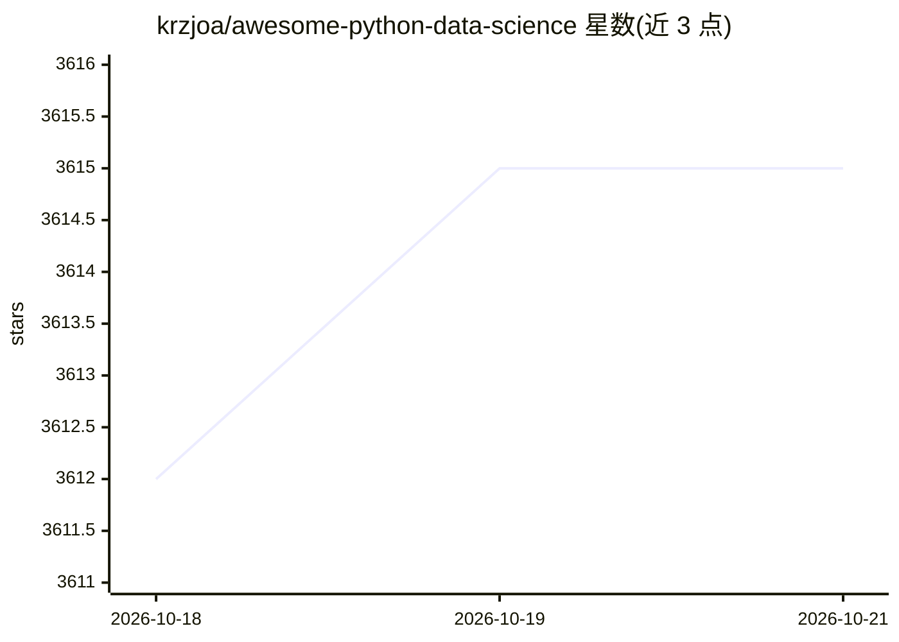

# krzjoa/awesome-python-data-science

⭐ 3,615 · CC-BY-4.0 · 推送 2026-04-13 · [GitHub](https://github.com/krzjoa/awesome-python-data-science) · [官网](https://krzjoa.github.io/awesome-python-data-science) · 个人维护

**Python 数据科学软件策展清单：机器学习/深度学习等库收录**

Awesome 系列的 Python 数据科学库聚合清单，按机器学习（通用/梯度提升/集成/核方法）、深度学习（PyTorch/TensorFlow/JAX/Keras）、AutoML、NLP、音频、计算机视觉、时间序列、强化学习等类别组织条目。每个条目为库的名称与一句话描述，部分附带 sklearn/PyTorch 兼容标签或 GPU 加速标注。面向需要为数据科学任务选择 Python 库的开发者与科研人员，本身不提供代码或安装方式，仅作选型参考目录。

## 筛选速览

| 维度 | 判定 | 备注 |
|---|---|---|
| AI 角色 | `ai-knowledge` | 知识聚合/清单类 |
| 许可风险 | `viral` | CC-BY-4.0 |
| 部署形态 | `None` |  |
| 模型依赖 | — | README 未给出锁定关系 |
| 硬件要求 | — | 无带数字的原话,不猜 |
| 安装摩擦 | `medium` | 含编译或系统依赖之一 |
| 成熟度 | — | 结构信号不足 |

## 能力要点

- 按机器学习、深度学习、AutoML、NLP、计算机视觉、时间序列、强化学习等类别组织
- 条目附带 sklearn / PyTorch / Keras 兼容性标签
- 覆盖 GPU 加速类库（cuML/XGBoost/ThunderGBM 等）

## 适用场景

- 为机器学习或深度学习项目挑选 Python 库
- 查找特定领域（时间序列/强化学习/NLP）可用工具
- 了解某库的框架兼容与 GPU 支持情况

## 场景标签

`精选清单` · 领域:学习与行业

## 证据(README 行号)

> L9: > Probably the best curated list of data science software in Python
> L13: ## Machine Learning

## 星数曲线

2026-10-18 3,612 → 2026-10-21 3,615（+3）

---
*卡片 v1 · prompt 1.4 · 生成 2026-10-20 · 置信度 high · 依据 README sha `c33bf4ed3be8` · [字段定义](../../DATASET.md)*
