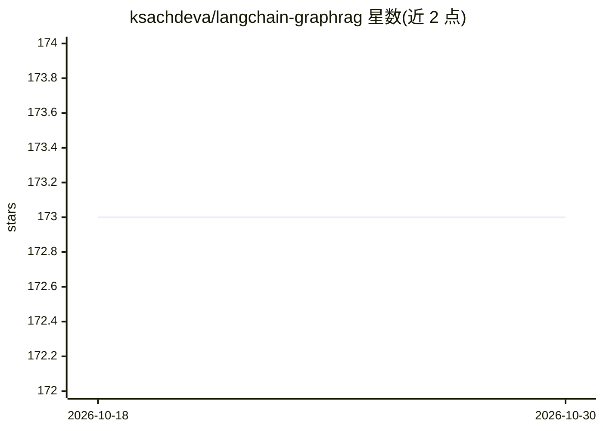

# ksachdeva/langchain-graphrag

⭐ 173 · Python · Apache-2.0 · 推送 2026-03-31 · [GitHub](https://github.com/ksachdeva/langchain-graphrag) · [官网](https://langchain-graphrag.readthedocs.io/en/latest/) · 个人维护

**基于 LangChain 的 GraphRAG 论文开源实现库**

论文《From Local to Global: A Graph RAG Approach to Query-Focused Summarization》(arXiv 2404.16130) 的独立重实现，核心库 langchain_graphrag 构建 LangChain 之上，提供 Text Unit Extraction、Graph Extraction 及 local/global 搜索的模块化 API，组件（LLM、embedding、向量库等）可按接口替换。重实现动机为官方版缺乏 LangChain/LlamaIndex 集成且仅支持 OpenAI/AzureOpenAI。附带 typer CLI 示例应用，需 Python 3.10+ 与 uv，README 自述库尚不完整（文档/测试待补）。

## 筛选速览

| 维度 | 判定 | 备注 |
|---|---|---|
| AI 角色 | `ai-ecosystem` | LLM/agent 周边工具 |
| 许可风险 | `permissive` | Apache-2.0 |
| 部署形态 | `library` | 以包/库形式分发 |
| 模型依赖 | locked-api |  |
| 硬件要求 | — | 无带数字的原话,不猜 |
| 安装摩擦 | `low` | 无编译、无系统依赖或容器化 |
| 成熟度 | `idea` | |

## 能力要点

- 实现 GraphRAG 论文的索引与 local/global 查询流程
- 基于 LangChain，组件可按接口替换（LLM/embedding/向量库）
- 提供 simple-app CLI（索引、全局搜索、本地搜索）与 VSCode devcontainer
- 官方版仅支持 OpenAI/AzureOpenAI，本实现依赖框架抽象支持更多 provider

## 适用场景

- 在 LangChain 技术栈中复现 GraphRAG 论文方法
- 替换自定义 LLM/embedding 组件做 GraphRAG 实验
- 对语料做全局主题与局部实体的查询式摘要

## 场景标签

`RAG` `知识图谱` · 领域:知识与检索

## 证据(README 行号)

> L7: This is an implementation of GraphRAG as described in
> L57: This is the core library that implements the GraphRAG paper. It is built on top of the `langchain` library.

## 星数曲线

2026-10-18 173 → 2026-10-30 173（+0）

---
*卡片 v1 · prompt 1.4 · 生成 2026-10-22 · 置信度 high · 依据 README sha `4855670bcfba` · [字段定义](../../DATASET.md)*
