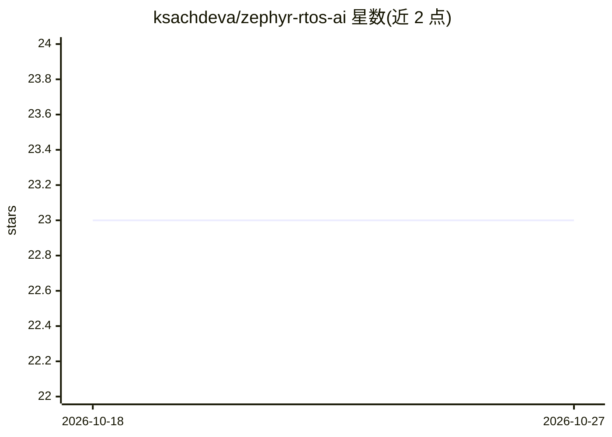

# ksachdeva/zephyr-rtos-ai

⭐ 23 · Python · Apache-2.0 · 推送 2026-06-10 · [GitHub](https://github.com/ksachdeva/zephyr-rtos-ai) · 个人维护

**Zephyr RTOS 固件开发 AI agent 技能包**

面向 Zephyr RTOS 嵌入式固件开发的 AI Agent 技能集：通过 npx skills add 安装，提供 26 个技能，覆盖蓝牙 BLE、设备树、Kconfig、内核线程与同步、GPIO/I2C/SPI/UART、文件系统、网络、电源管理、Ztest 测试等子系统，供 AI agent 在 Zephyr 项目中辅助编码。README 建议搭配 zephyr-template 项目结构（基于 uv 与 poe），并附 AGENTS.md 示例；TODO 中列出扩展技能与 spec driven development 支持尚未完成。

## 筛选速览

| 维度 | 判定 | 备注 |
|---|---|---|
| AI 角色 | `ai-knowledge` | 知识聚合/清单类 |
| 许可风险 | `permissive` | Apache-2.0 |
| 部署形态 | `library` | 以包/库形式分发 |
| 模型依赖 | — | README 未给出锁定关系 |
| 硬件要求 | — | 无带数字的原话,不猜 |
| 安装摩擦 | `low` | 无编译、无系统依赖或容器化 |
| 成熟度 | — | 结构信号不足 |

## 能力要点

- 26 个 Zephyr 子系统技能（BLE、devicetree、Kconfig、线程/同步、总线驱动等）
- npx skills add 一条命令安装
- 配套 zephyr-template 与 poe 任务减少 agent 上下文消耗
- 附带示例 AGENTS.md 供项目定制

## 适用场景

- 给 AI agent 装上 Zephyr 固件开发知识，辅助编写驱动与内核代码
- 在 Zephyr 项目中让 agent 处理 devicetree、Kconfig 配置
- 用 poe 任务让 agent 构建项目而不过多消耗上下文

## 场景标签

`编码 Agent` `提示工程` · 领域:Agent 开发

## 证据(README 行号)

> L3: An Agent Hardness for AI assisted embedded firmware development
> L13: ## Available Agent Skills

## 星数曲线

2026-10-18 23 → 2026-10-27 23（+0）

---
*卡片 v1 · prompt 1.4 · 生成 2026-10-27 · 置信度 mid · 依据 README sha `409b9785d764` · [字段定义](../../DATASET.md)*
