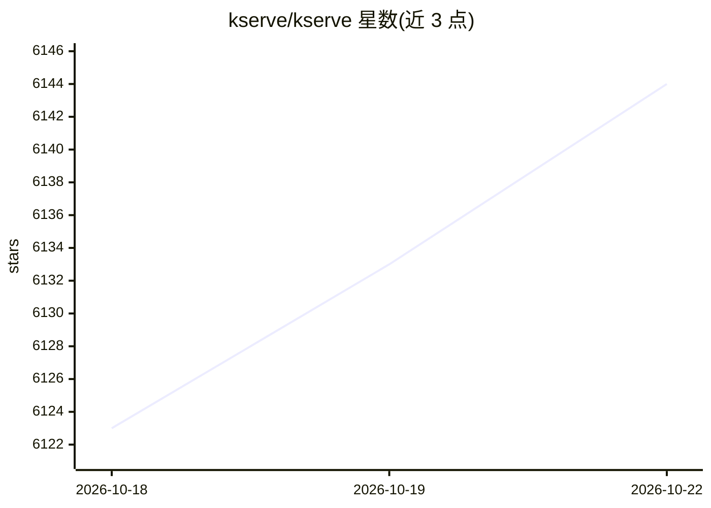

# kserve/kserve

⭐ 6,144 · Go · Apache-2.0 · 推送 2026-10-21 · [GitHub](https://github.com/kserve/kserve) · [官网](https://kserve.github.io/website/) · 组织维护

**Kubernetes 上的标准化 AI 推理服务平台（生成式+预测式）**

CNCF 孵化项目，在 Kubernetes 上统一部署生成式与预测式 AI 推理：生成式方面支持 vLLM 与 llm-d 后端、OpenAI 兼容推理协议、GPU 加速、模型缓存与 KV cache 卸载；预测式方面支持 TensorFlow/PyTorch/scikit-learn/XGBoost/ONNX 等多框架、金丝雀发布、InferenceGraph 流水线、可解释性与监控。安装提供标准 Kubernetes、Knative 无服务器、ModelMesh 与本地快速安装四种方式，亦是 Kubeflow 的组件。

## 筛选速览

| 维度 | 判定 | 备注 |
|---|---|---|
| AI 角色 | `ai-ecosystem` | LLM/agent 周边工具 |
| 许可风险 | `permissive` | Apache-2.0 |
| 部署形态 | `None` |  |
| 模型依赖 | local-ok | 支持本地模型 |
| 硬件要求 | — | 无带数字的原话,不猜 |
| 安装摩擦 | `low` | 无编译、无系统依赖或容器化 |
| 成熟度 | — | 结构信号不足 |

## 能力要点

- 在 Kubernetes 上统一生成式与预测式 AI 推理部署
- 支持 vLLM/llm-d 后端与 OpenAI 兼容推理协议
- 多框架预测模型支持（TensorFlow/PyTorch/scikit-learn/XGBoost/ONNX）
- 请求级自动扩缩容与 scale-to-zero

## 适用场景

- 在 Kubernetes 集群上规模化部署与运维 LLM 推理服务
- 用统一接口部署多框架预测模型并做金丝雀发布
- 企业级 AI 工作负载的自动扩缩容与成本控制

## 场景标签

`推理引擎` · 领域:训练与推理

## 证据(README 行号)

> L10: KServe is a standardized distributed generative and predictive AI inference platform for scalable, multi-framework 
> L20: Single platform that unifies Generative and Predictive AI inference on Kubernetes. Simple enough for quick deployme

## 星数曲线

2026-10-18 6,123 → 2026-10-22 6,144（+21）

---
*卡片 v1 · prompt 1.4 · 生成 2026-10-20 · 置信度 high · 依据 README sha `1ca184664e9b` · [字段定义](../../DATASET.md)*
