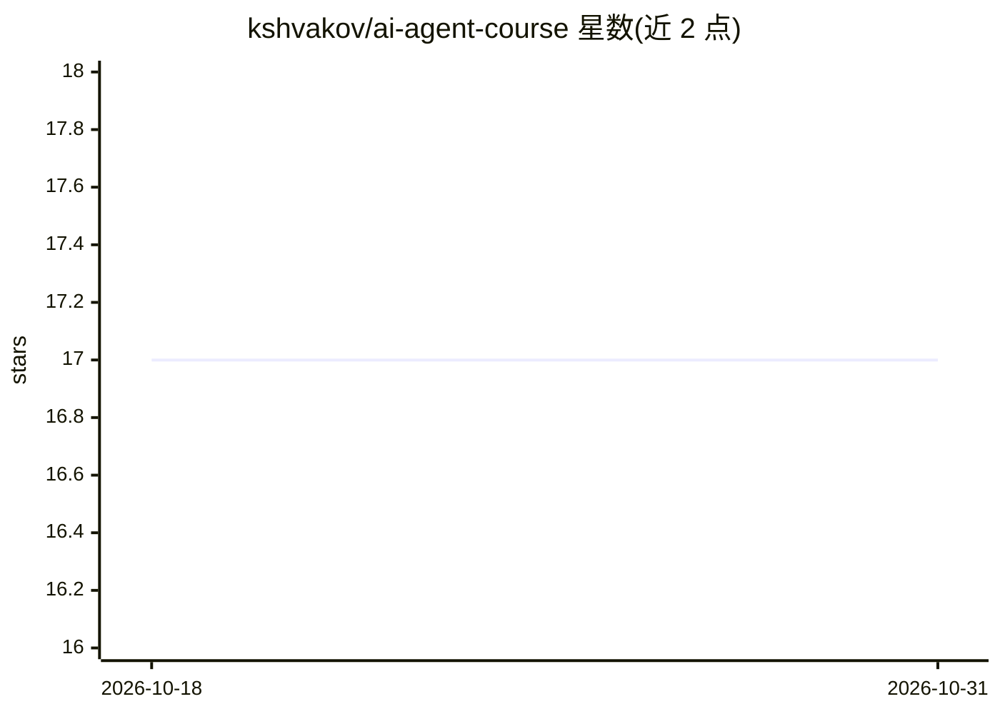

# kshvakov/ai-agent-course

⭐ 17 · Go · 推送 2026-10-16 · [GitHub](https://github.com/kshvakov/ai-agent-course) · [官网](https://kshvakov.github.io/ai-agent-course/) · 个人维护

**Go 语言自主 AI agent 实战课程：手册加 13 个实验**

面向程序员的动手课程，教授用 Go 构建自主 AI agent。形式为一本设计手册（涵盖 LLM 原理、提示词编程、ReAct 循环、安全、RAG、多 agent、评测与生产就绪等章节）加 Lab 00 能力检测与 12 个必做、1 个可选实验：学生在预写好的 Go 代码骨架中补全 TODO，每实验配 MANUAL.md 学习指南与 SOLUTION.md。工具链为 Go 1.21+，支持本地 LLM（LM Studio/Ollama）或 OpenAI API key，通过环境变量配置中立的 llm 包，Docker 为可选项。课程提供英/俄双语版本。

## 筛选速览

| 维度 | 判定 | 备注 |
|---|---|---|
| AI 角色 | `ai-knowledge` | 知识聚合/清单类 |
| 许可风险 | `none` | — |
| 部署形态 | `None` |  |
| 模型依赖 | local-ok | 支持本地模型 |
| 硬件要求 | — | 无带数字的原话,不猜 |
| 安装摩擦 | `low` | 无编译、无系统依赖或容器化 |
| 成熟度 | — | 结构信号不足 |

## 能力要点

- 手册 + 13 个实验（Lab 00-13），代码骨架填空式教学
- 覆盖 Function Calling、ReAct、RAG、多 Agent、记忆与上下文工程、工具服务器
- 本地 LLM（LM Studio/Ollama）或 OpenAI API 可选，环境变量配置中立 llm 包
- Lab 00 提供模型能力基准测试（JSON/指令遵循/Function Calling）

## 适用场景

- 我想系统学习如何用 Go 从零构建自主 AI agent
- 我希望理解 LLM agent 内部机制并通过实验练习掌握
- 我想检测自己的本地模型是否适合跑 agent 课程实验

## 场景标签

`教程课程` · 领域:学习与行业

## 证据(README 行号)

> L10: Welcome to a practical course on building autonomous AI agents in Go!
> L86: The course consists of a preparatory stage (Lab 00) and 12 main laboratory assignments (Lab 01-12), plus 1 optional

## 星数曲线

2026-10-18 17 → 2026-10-31 17（+0）

---
*卡片 v1 · prompt 1.4 · 生成 2026-10-29 · 置信度 high · 依据 README sha `42cf55498aaf` · [字段定义](../../DATASET.md)*
