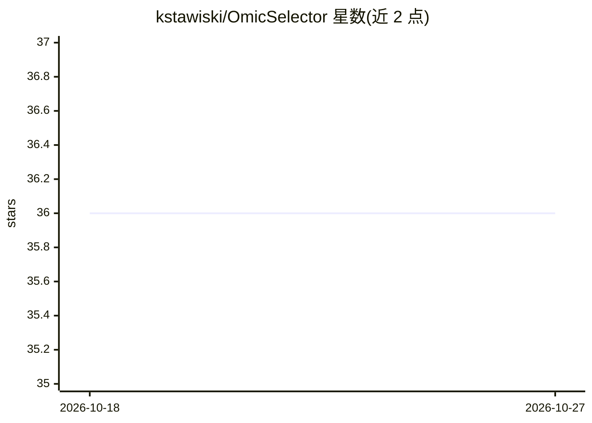

# kstawiski/OmicSelector

⭐ 36 · R · NOASSERTION · 推送 2026-10-25 · [GitHub](https://github.com/kstawiski/OmicSelector) · [官网](https://kstawiski.github.io/OmicSelector/) · 个人维护

**面向组学数据的生物标志物筛选与深度学习诊断 R 包**

基于 mlr3 生态的 R 包，用于从高通量组学数据（如 miRNA-seq、RNA-seq）中做特征选择与诊断模型开发。核心机制：特征选择严格限制在交叉验证折内以防数据泄漏、分离内外层的嵌套交叉验证、Nogueira 稳定性指数、多目标选择；2.6.0 起提供 73 个单样本评分方法并可冻结部署为单标本打分对象。支持多组学输入、mlr3torch 自编码器迁移学习，附带 Shiny WebUI 与 Docker 部署（含 RStudio Server）。

## 筛选速览

| 维度 | 判定 | 备注 |
|---|---|---|
| AI 角色 | `ai-native` | 本体是模型或模型工具 |
| 许可风险 | `none` | NOASSERTION |
| 部署形态 | `self-host` | docker 或自建部署 |
| 模型依赖 | — | README 未给出锁定关系 |
| 硬件要求 | — | 无带数字的原话,不猜 |
| 安装摩擦 | `low` | 无编译、无系统依赖或容器化 |
| 成熟度 | — | 结构信号不足 |

## 能力要点

- 特征选择严格限制在 CV 折内，嵌套交叉验证防数据泄漏
- 73 个单样本评分方法，可冻结为逐标本打分对象
- 20+ 种特征选择过滤方法（ANOVA/mRMR/Relief 等）
- 提供 Shiny WebUI 与 Docker 部署（WebUI + RStudio Server）

## 适用场景

- 从 RNA-seq/miRNA-seq 数据中筛选可复现的生物标志物组合
- 构建并验证高维组学数据的分类诊断模型
- 在无参考队列条件下对单样本进行打分部署

## 场景标签

`数据分析` · 领域:效率与自动化

## 证据(README 行号)

> L3: **Rigorous biomarker discovery from high-dimensional omics data with zero data leakage.**
> L43: OmicSelector is an R package for biomarker discovery that enforces methodologically sound machine learning practice
> L145: Since 2.6.0, OmicSelector has provided within-sample classification methods for

## 星数曲线

2026-10-18 36 → 2026-10-27 36（+0）

---
*卡片 v1 · prompt 1.4 · 生成 2026-10-25 · 置信度 high · 依据 README sha `4682774050e0` · [字段定义](../../DATASET.md)*
