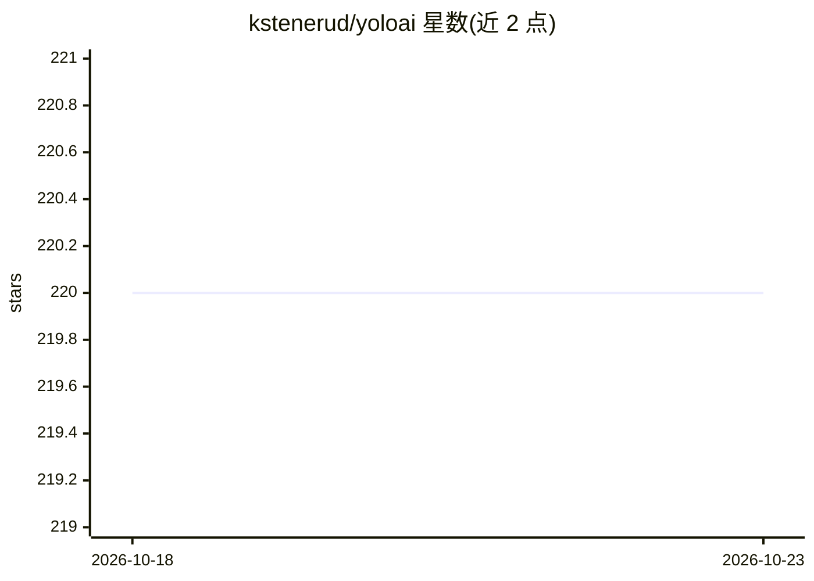

# kstenerud/yoloai

⭐ 220 · Go · MIT · 推送 2026-10-12 · [GitHub](https://github.com/kstenerud/yoloai) · [官网](https://yoloai.dev) · 个人维护

**AI 编程 agent 的沙箱运行器：隔离文件/凭据/网络**

Go 编写的命令行工具，为 AI 编程 agent（Claude Code、Codex、Gemini CLI、Aider、OpenCode 等）提供一次性沙箱环境：agent 在项目副本中编辑与执行命令，完成后通过 diff/apply 将选定的提交合回真实项目。凭据以只读挂载或宿主侧代理方式注入，API key 不进入沙箱；支持网络隔离与从 runc、gVisor 到 Kata VM 的多级隔离。后端支持 Docker、Podman、containerd、Apple Container、Tart 与 Seatbelt。当前为公开 beta。

## 筛选速览

| 维度 | 判定 | 备注 |
|---|---|---|
| AI 角色 | `ai-ecosystem` | LLM/agent 周边工具 |
| 许可风险 | `permissive` | MIT |
| 部署形态 | `desktop` | 安装包/桌面程序 |
| 模型依赖 | locked-api |  |
| 硬件要求 | — | 无带数字的原话,不猜 |
| 安装摩擦 | `low` | 无编译、无系统依赖或容器化 |
| 成熟度 | `idea` | |

## 能力要点

- 6 种沙箱后端：Docker/Podman/containerd/Apple Container/Tart/Seatbelt
- 凭据代理使 API key 保持在宿主侧（Claude/Gemini/Codex）
- copy/diff/apply 工作流，apply 时保留或合并沙箱内提交
- 内置 5 种 agent 模式加 shell 模式，支持双向 MCP

## 适用场景

- 让 AI 编程 agent 无人值守地改代码而不影响真实项目
- 避免把 API key 等凭据暴露给沙箱内的 agent
- 在 CI 脚本中用 headless 一次性模式运行 agent 任务

## 场景标签

 · 领域:开发工具/agent 安全

## 证据(README 行号)

> L3: **Sandboxed runner for AI coding agents. No permission fatigue, no credentials in the box, no changes to your projec
> L11: AI coding agents work best with the guardrails off, and that's a terrible way to run them on your real machine. yol
> L133: - Claude Code, Codex, Gemini CLI, Aider, and OpenCode built in, plus a `shell` mode for anything else.

## 星数曲线

2026-10-18 220 → 2026-10-23 220（+0）

---
*卡片 v1 · prompt 1.4 · 生成 2026-10-22 · 置信度 mid · 依据 README sha `cde806df6af4` · [字段定义](../../DATASET.md)*
