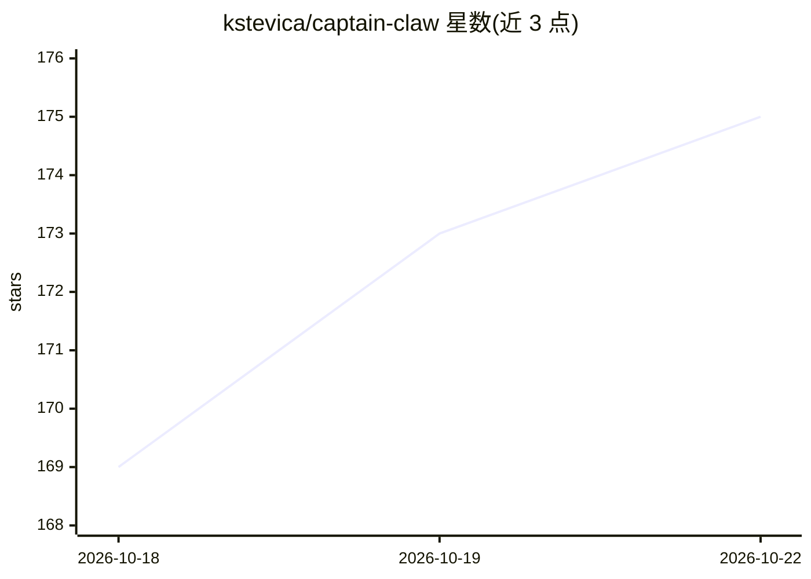

# kstevica/captain-claw

⭐ 175 · Python · MIT · 推送 2026-10-21 · [GitHub](https://github.com/kstevica/captain-claw) · [官网](https://captain-claw.com) · 个人维护

**自托管多 AI agent 编排框架：多模式协同与完整编码流水线**

Python 实现的自托管 agent 编排框架，提供七种编排模式（Agent Forge、Agent Council、Basna、Vatra、Code、Flight Deck、Bat）、每个 agent 51 个内置工具、6 层共享记忆与 31 个预置专家角色。Code 模式为计划→构建→三独立评审→修复循环的编码流水线，每阶段 git 提交并导出可审计 Markdown 记录。支持接入 OpenAI、Anthropic、Gemini、DeepSeek、Ollama、OpenRouter 或纯本地运行；0.8.0 加入团队多用户、邮箱/眼镜/M5Stack 硬件语音客户端等界面。MIT 许可，作者声明独立开发（L70）。

## 筛选速览

| 维度 | 判定 | 备注 |
|---|---|---|
| AI 角色 | `ai-ecosystem` | LLM/agent 周边工具 |
| 许可风险 | `permissive` | MIT |
| 部署形态 | `self-host` | docker 或自建部署 |
| 模型依赖 | local-ok | 支持本地模型 |
| 硬件要求 | — | 无带数字的原话,不猜 |
| 安装摩擦 | `low` | 无编译、无系统依赖或容器化 |
| 成熟度 | — | 结构信号不足 |

## 能力要点

- 七种编排模式与 31 个预置专家角色
- Code 编码流水线：计划→批准→构建→三并行独立评审→封顶修复循环
- 模型无关：可接多家商业 API 或用 Ollama 100% 本地运行
- M5Stack StickS3/StopWatch 按键说话语音客户端与团队多用户 Flight Deck

## 适用场景

- 组建并监控多专家 agent 团队完成研究或工程任务
- 用带独立评审的编码流水线在本地仓库上开发软件
- 团队共享 agent 与密钥，在收件箱、眼镜、手持设备上使用

## 场景标签

`Agent 框架` `多智能体` `编码 Agent` `代码审查` · 领域:Agent 开发

## 证据(README 行号)

> L19: A **self-hosted framework for orchestrating fleets of specialist AI agents** — from **ensemble reasoning** (seven o
> L31: Describe what you want built. A router sizes the job; big work runs **plan → your approval → build → three independ

## 星数曲线

2026-10-18 169 → 2026-10-22 175（+6）

---
*卡片 v1 · prompt 1.4 · 生成 2026-10-22 · 置信度 mid · 依据 README sha `4d9a1e7cd1e1` · [字段定义](../../DATASET.md)*
