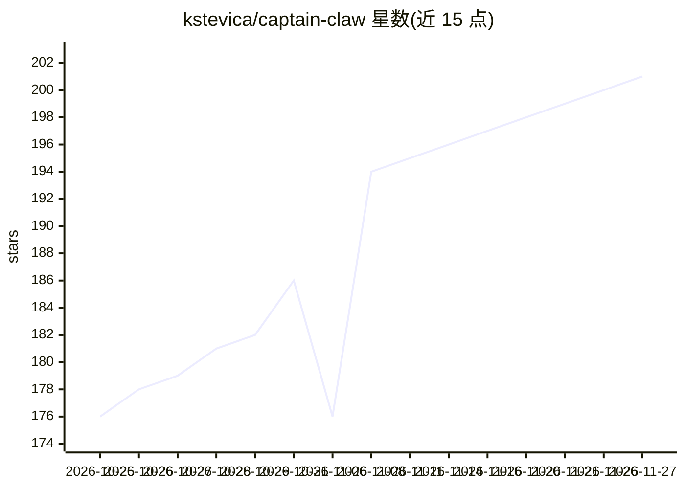

# kstevica/captain-claw

⭐ 201 · Python · MIT · 推送 2026-11-26 · [GitHub](https://github.com/kstevica/captain-claw) · [官网](https://captain-claw.com) · 个人维护

**自托管多 agent 编排平台：团队与个人用一套面板指挥 AI agent 舰队**

Python 编写的自托管多 agent 平台（MIT），核心 Flight Deck 提供 7 种编排模式、132 个预设 agent 原型、85 个内置工具与 6 层共享记忆；含 plan→build→独立评审的编码流水线与 Crew（运行 Claude Code、Codex、OpenCode 等 CLI agent），支持确定性 Flows、常驻任务 First Mate、任务核验 Taskboard、数据脱敏与加密保险库。多 deck 经 BotPort 互联，入口覆盖 Web、WhatsApp、Telegram、团队 kiosk 及 M5Stack/Waveshare 语音设备。pip 安装，支持任意 LLM provider 或 100% 本地 Ollama。

## 筛选速览

| 维度 | 判定 | 备注 |
|---|---|---|
| AI 角色 | `ai-native` | 本体是模型或模型工具 |
| 许可风险 | `permissive` | MIT |
| 部署形态 | `library` | 以包/库形式分发 |
| 模型依赖 | local-ok | 支持本地模型 |
| 硬件要求 | — | 无带数字的原话,不猜 |
| 安装摩擦 | `low` | 无编译、无系统依赖或容器化 |
| 成熟度 | — | 结构信号不足 |

## 能力要点

- 7 种编排模式（盲集成、协作黑板、仲裁议会等）与 Agent Forge 自动组建团队
- 编码流水线：计划→审批→构建→三个独立评审，每阶段 git 提交
- 6 层共享记忆、Taskboard 任务核验与 tamper-evident 工具调用登记
- 匿名化管道：模型读取前将姓名/公司/号码替换为 token，答后还原

## 适用场景

- 给团队搭一个自托管的多 agent 工作台与任务看板
- 用 plan→review 流水线在自有 git 仓库里交付软件
- 通过 WhatsApp/Telegram/手表语音随时调度家中与 VPS 上的 agent
- 用 Ollama 本地模型跑 agent，数据不出机器

## 场景标签

`多智能体` `Agent 记忆` `编码 Agent` `工作流自动化` · 领域:Agent 开发

## 证据(README 行号)

> L13: > Most AI tools give you one agent in a chat box. Captain **Flight Deck** is a multi-agent command center: spawn sp
> L35: - **🔓 Yours, end to end.** Self-hosted, MIT, bring your own keys or run 100% local with Ollama. No lock-in.
> L40: pip install captain-claw

## 星数曲线

2026-10-25 176 → 2026-11-27 201（+25）

---
*卡片 v1 · prompt 1.4 · 生成 2026-11-26 · 置信度 high · 依据 README sha `175554977fae` · [字段定义](../../DATASET.md)*
