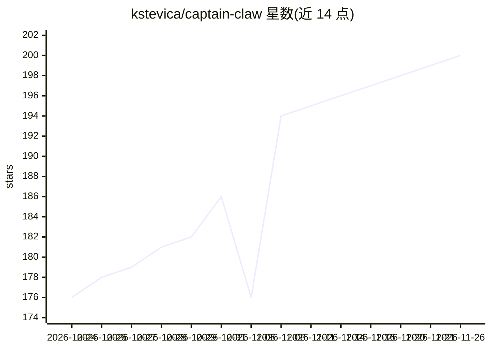

# kstevica/captain-claw

⭐ 200 · Python · MIT · 推送 2026-11-25 · [GitHub](https://github.com/kstevica/captain-claw) · [官网](https://captain-claw.com) · 个人维护

**自托管多智能体平台：编排专家团队并交付工作成果**

Python 编写的自托管多智能体指挥平台（MIT 许可）：提供 7 种编排模式、132 个预置角色模板、6 层共享记忆、83 个内置工具、Code 编码流水线（计划→构建→独立审查）、Flows 确定性工作流、任务看板与审批机制，支持经 BotPort 跨设备（VPS/笔记本/树莓派）互借 agent，带团队 kiosk、定时任务（First Mate）、匿名化与数据房间，可接入 WhatsApp/Telegram/M5Stack 语音设备。可用任何主流 LLM，或经 Ollama 100% 本地运行。

## 筛选速览

| 维度 | 判定 | 备注 |
|---|---|---|
| AI 角色 | `ai-ecosystem` | LLM/agent 周边工具 |
| 许可风险 | `permissive` | MIT |
| 部署形态 | `library` | 以包/库形式分发 |
| 模型依赖 | local-ok | 支持本地模型 |
| 硬件要求 | — | 无带数字的原话,不猜 |
| 安装摩擦 | `low` | 无编译、无系统依赖或容器化 |
| 成熟度 | — | 结构信号不足 |

## 能力要点

- 7 种编排模式与 132 个预置 agent 角色模板
- 编码流水线：计划→批准→构建→三个独立审查者→修复
- 6 层跨会话共享记忆与匿名化隐私门
- 支持 WebSocket/HTTP/签名 webhook/MCP 双向接入

## 适用场景

- 自托管搭建专家 agent 团队协作完成研究或运维任务
- 用编码流水线在自己仓库里以多审查流程交付代码
- 团队 kiosk 中按计划限制共享使用 agent
- 以 Ollama 本地模型运行保证数据不出本机

## 场景标签

`Agent 记忆` `多智能体` `编码 Agent` · 领域:Agent 开发

## 证据(README 行号)

> L13: > Most AI tools give you one agent in a chat box. Captain **Flight Deck** is a multi-agent command center: spawn sp
> L35: - **🔓 Yours, end to end.** Self-hosted, MIT, bring your own keys or run 100% local with Ollama. No lock-in.

## 星数曲线

2026-10-24 176 → 2026-11-26 200（+24）

---
*卡片 v1 · prompt 1.4 · 生成 2026-11-25 · 置信度 high · 依据 README sha `b5e7ebaa2779` · [字段定义](../../DATASET.md)*
