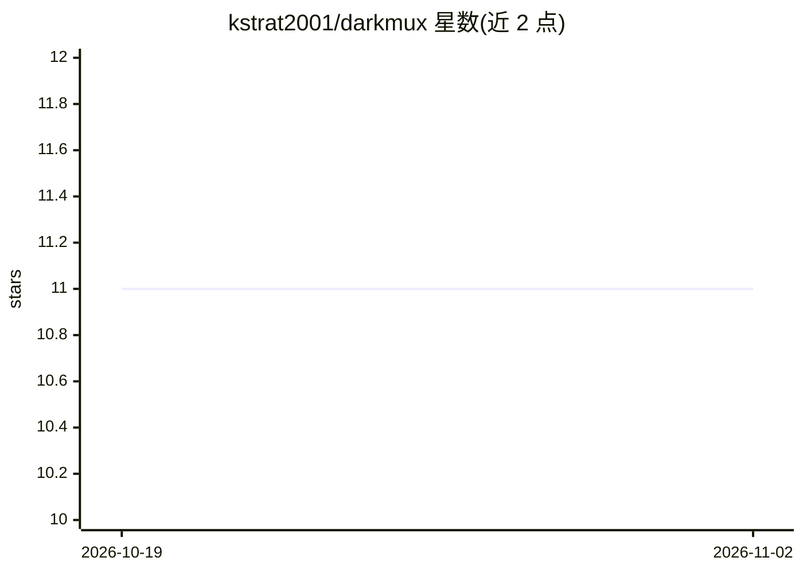

# kstrat2001/darkmux

⭐ 11 · Rust · MIT · 推送 2026-11-01 · [GitHub](https://github.com/kstrat2001/darkmux) · [官网](https://darkmux.com) · 个人维护

**面向 Apple Silicon 的本地 AI 任务编排运行时：多机舰队执行任务图**

darkmux 将一台或多台通过 tailnet 连接的 Mac 组成本地 AI 舰队：以配置定义 mission，由角色分工的模型组（coder/reviewer/judge 等）以任务图形式执行，关键步骤需人工签核，每次派发记录机器、模型与角色，可选 BLAKE3 哈希链审计日志。本地座位运行在 LMStudio 上，座位也可改用 OpenAI 兼容云端端点或 Claude（含提示缓存）；Docker 承载派发运行时。附 lab 模块在用户硬件上测量工作负载表现。单操作者设计，非多租户团队工具；Linux 可编译但未经日常验证。

## 筛选速览

| 维度 | 判定 | 备注 |
|---|---|---|
| AI 角色 | `ai-ecosystem` | LLM/agent 周边工具 |
| 许可风险 | `permissive` | MIT |
| 部署形态 | `None` |  |
| 模型依赖 | locked-api |  |
| 硬件要求 | — | 无带数字的原话,不猜 |
| 安装摩擦 | `low` | 无编译、无系统依赖或容器化 |
| 成熟度 | `idea` | |

## 能力要点

- 配置定义 mission，任务图执行，关键步骤人工签核门控
- 角色化模型组（coder/reviewer/judge/crawler）按座位配置本地或托管模型
- 每次派发输出结构化溯源记录，可选 BLAKE3 哈希链审计日志与完整性校验
- lab 子命令在本地硬件上测量工作负载（wall clock、轨迹、验证结果）

## 适用场景

- 用本地模型对工作区 diff 做多座位 PR 审查
- 把多台 Mac 组成可从手机监控的本地 AI 任务舰队
- 在同一硬件上对模型配置做基线-变更-复测的调优实验

## 场景标签

`Agent 框架` `代码审查` `模型评测` · 领域:Agent 开发

## 证据(README 行号)

> L10: darkmux turns a Mac (or a few of them on a tailnet) into a working local-AI fleet: config-defined **missions** run 
> L26: Local seats run on LMStudio (one downloaded model minimum). Any seat can instead be staffed by a hosted OpenAI-comp

## 星数曲线

2026-10-19 11 → 2026-11-02 11（+0）

---
*卡片 v1 · prompt 1.4 · 生成 2026-11-02 · 置信度 high · 依据 README sha `d6febf04a654` · [字段定义](../../DATASET.md)*
