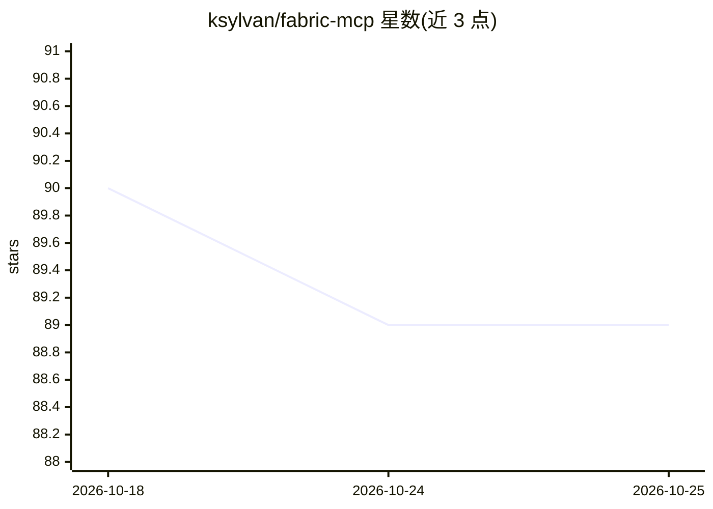

# ksylvan/fabric-mcp

⭐ 89 · Python · MIT · 推送 2026-10-25 · [GitHub](https://github.com/ksylvan/fabric-mcp) · 个人维护

**把 Fabric AI 框架能力接入 MCP 客户端的 MCP 服务器**

独立运行的 MCP 服务器，将 MCP 请求翻译为对运行中 Fabric 实例（fabric --serve）REST API 的调用，使 IDE 扩展、聊天界面等 MCP 客户端能直接使用 Fabric 的 patterns、models、strategies 与配置。提供 fabric_run_pattern 等 MCP 工具，并将 Fabric patterns 同时暴露为 MCP prompts。支持 stdio 与 HTTP streamable 两种传输方式，通过 FABRIC_BASE_URL / FABRIC_API_KEY 等环境变量配置。依赖外部已运行的 Fabric 实例。

## 筛选速览

| 维度 | 判定 | 备注 |
|---|---|---|
| AI 角色 | `ai-ecosystem` | LLM/agent 周边工具 |
| 许可风险 | `permissive` | MIT |
| 部署形态 | `library` | 以包/库形式分发 |
| 模型依赖 | — | README 未给出锁定关系 |
| 硬件要求 | — | 无带数字的原话,不猜 |
| 安装摩擦 | `low` | 无编译、无系统依赖或容器化 |
| 成熟度 | — | 结构信号不足 |

## 能力要点

- MCP 请求翻译为 Fabric REST API 调用（fabric --serve）
- 提供列出/获取/运行 patterns、列出 models/strategies、读取配置的 MCP 工具
- Fabric patterns 同时暴露为 MCP prompts
- 支持 stdio 与 HTTP streamable 两种传输

## 适用场景

- 在 IDE 中调用 Fabric 的 patterns 做代码解释或重构
- 在 MCP 兼容聊天界面中使用 Fabric 提示词模板
- 让 MCP 客户端复用已有 Fabric 实例的模型与配置

## 场景标签

`提示工程` · 领域:Agent 开发

## 证据(README 行号)

> L17: This project implements a standalone server that bridges the gap between [Daniel Miessler's Fabric framework][fabri
> L27: - **Fabric MCP Server:** This project acts as an MCP server, translating MCP requests into calls to a running Fabri
> L35: - **Expose Fabric Functionality:** Provide MCP tools to list patterns, get pattern details, run patterns, list mode

## 星数曲线

2026-10-18 90 → 2026-10-25 89（-1）

---
*卡片 v1 · prompt 1.4 · 生成 2026-10-23 · 置信度 high · 依据 README sha `ed06dc23e872` · [字段定义](../../DATASET.md)*
