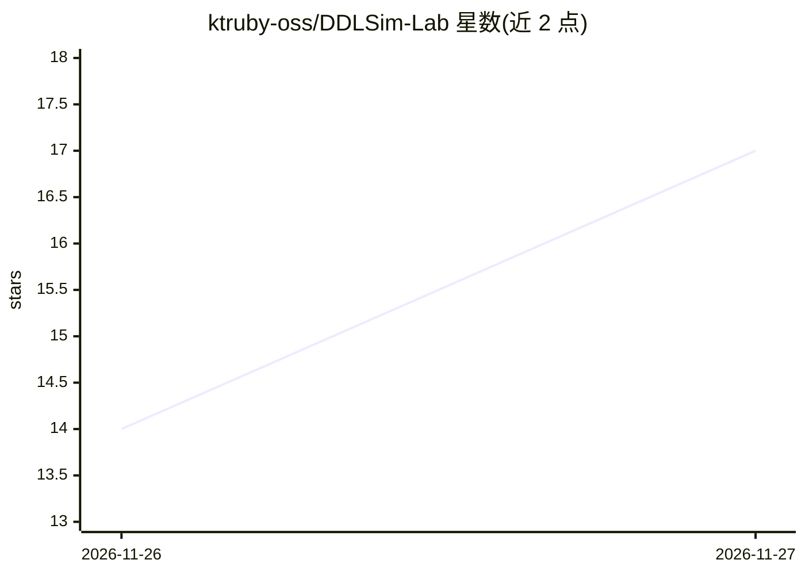

# ktruby-oss/DDLSim-Lab

⭐ 17 · Python · MIT · 推送 2026-11-23 · [GitHub](https://github.com/ktruby-oss/DDLSim-Lab) · [官网](https://ktruby-oss.github.io/DDLSIM/) · 个人维护

**用裸金属节点做分布式系统与安全研究的仿真环境**

DDLSim-Lab 是一个面向系统研究的开源分布式仿真环境，要求部署在裸金属节点上以避免虚拟化层带来的性能测量噪声。提供云与裸金属对比测量工具、网络仿真引擎（延迟/抖动/丢包/链路故障）、网络安全靶场生成器、Kubernetes 基准套件，并通过 Prometheus/Grafana 提供实时观测。面向研究者、教授与学生，提供可复现、无需昂贵物理测试床的实验环境，采用 MIT 许可并寻求基础设施捐赠。

## 筛选速览

| 维度 | 判定 | 备注 |
|---|---|---|
| AI 角色 | `ai-enhanced` | 去掉 AI 部分产品仍成立 |
| 许可风险 | `permissive` | MIT |
| 部署形态 | `None` |  |
| 模型依赖 | — | README 未给出锁定关系 |
| 硬件要求 | — | 无带数字的原话,不猜 |
| 安装摩擦 | `low` | 无编译、无系统依赖或容器化 |
| 成熟度 | — | 结构信号不足 |

## 能力要点

- 要求裸金属部署以保证网络与性能测量的确定性
- 网络仿真引擎模拟 WAN 特性、丢包、延迟与抖动
- 网络安全靶场生成器支持红蓝队训练环境
- Prometheus 导出器与 Grafana 仪表盘实时观测

## 适用场景

- 做云与裸金属的性能对比实验
- 在受控条件下测试共识协议与分布式中间件
- 搭建红蓝队攻防训练靶场
- 评估 MPI 应用与 HPC 工作负载

## 场景标签

`网络安全` · 领域:学习与行业

## 证据(README 行号)

> L29: DDLSim-Lab is an open-source research project that provides a distributed simulation environment using bare metal n
> L58: - **High-performance computing (HPC) workload evaluation** – Evaluate MPI applications, scientific simulations, and

## 星数曲线

2026-11-26 14 → 2026-11-27 17（+3）

---
*卡片 v1 · prompt 1.4 · 生成 2026-11-26 · 置信度 mid · 依据 README sha `661ff754a277` · [字段定义](../../DATASET.md)*
