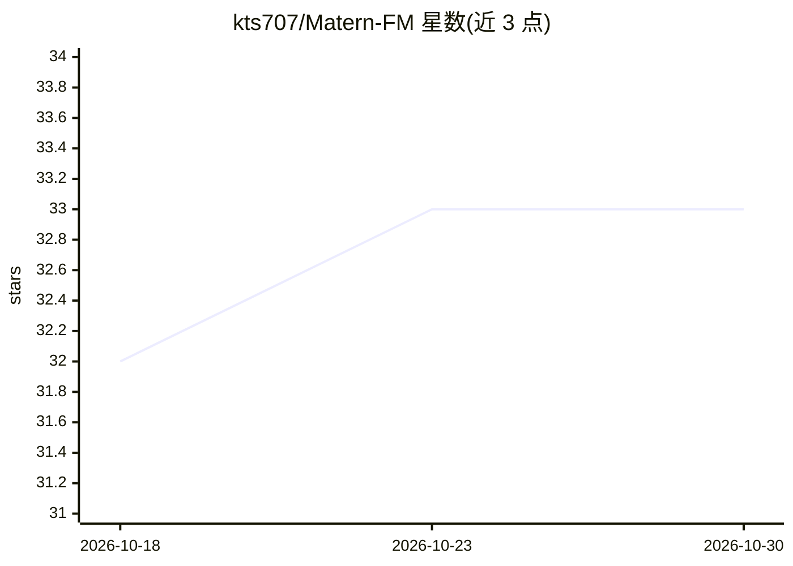

# kts707/Matern-FM

⭐ 33 · Python · MIT · 推送 2026-07-09 · [GitHub](https://github.com/kts707/Matern-FM) · [官网](https://matern-fm.github.io/) · 组织维护

**SIGGRAPH 2026 论文官方代码：三角网格上的 Matérn 噪声流匹配生成**

论文《Matérn Noise for Triangulation-Agnostic Flow Matching on Meshes》的官方代码发布，发表于 ACM Transactions on Graphics（SIGGRAPH 2026）。方法为在三角网格上使用 Matérn 噪声进行与三角剖分无关的 Flow Matching，用于网格变形生成。提供独立的 Matérn 噪声采样脚本、预训练模型（SMPL 人体/Stanford bunny/Fish）、训练与测试流程，以及弹性体平衡态数据集生成脚本。训练假设单张 NVIDIA H100（80GB VRAM），通过 conda 环境安装并使用自定义版 cholespy 包缓存求解器。

## 筛选速览

| 维度 | 判定 | 备注 |
|---|---|---|
| AI 角色 | `ai-native` | 本体是模型或模型工具 |
| 许可风险 | `permissive` | MIT |
| 部署形态 | `None` |  |
| 模型依赖 | — | README 未给出锁定关系 |
| 硬件要求 | `gpu-24g` | |
| 安装摩擦 | `low` | 无编译、无系统依赖或容器化 |
| 成熟度 | — | 结构信号不足 |

## 能力要点

- 三角网格上的 Matérn 噪声采样独立脚本
- 提供 SMPL/bunny/Fish 预训练模型与演示脚本
- 支持任意源网格设置，自定义 cholespy 缓存求解器以减少训练时间
- 提供弹性体平衡态数据集生成脚本

## 适用场景

- 研究者复现论文中的网格变形生成实验
- 在自有三角网格上采样 Matérn 噪声
- 基于提供的代码与数据训练自己的流匹配模型

## 场景标签

`模型训练` · 领域:训练与推理

## 证据(README 行号)

> L5: Official code release for Matérn Noise for Triangulation-Agnostic Flow Matching on Meshes, by Tianshu Kuai, Arman Ma
> L19: We provide stand-alone example scripts for sampling Matérn noise on a triangle mesh.
> L35: Test our pre-trained models on the source meshes under `demo/meshes`. The generated deformed meshes are stored unde

## 星数曲线

2026-10-18 32 → 2026-10-30 33（+1）

---
*卡片 v1 · prompt 1.4 · 生成 2026-10-25 · 置信度 high · 依据 README sha `228988d2f9c7` · [字段定义](../../DATASET.md)*
