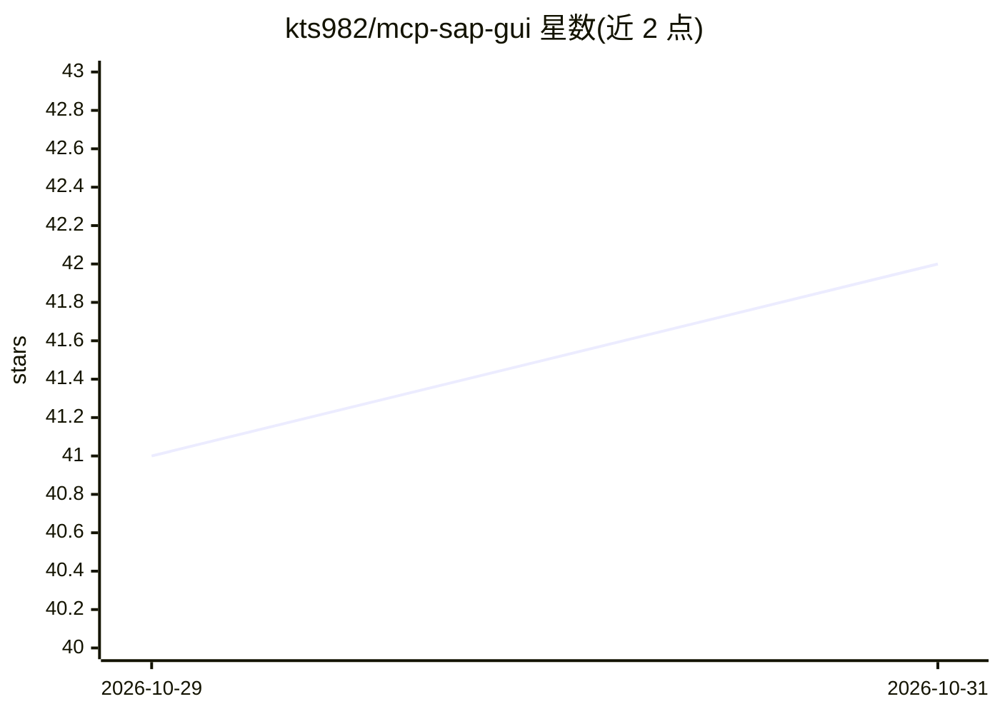

# kts982/mcp-sap-gui

⭐ 42 · Python · MIT · 推送 2026-10-28 · [GitHub](https://github.com/kts982/mcp-sap-gui) · [官网](https://pypi.org/project/mcp-sap-gui/) · 个人维护

**让 AI 助手通过 MCP 操作 SAP GUI 的服务器**

基于 Model Context Protocol 的本地服务器，通过 SAP 官方 Scripting API 让 AI 助手在 Windows 版 SAP GUI 中读屏与表格、填写字段、执行事务与处理弹窗。兼容可启动本地服务器的 MCP 客户端（Claude Code、GitHub Copilot、Codex 等）。保存操作默认需人工确认，并提供事务策略、只读模式与审计日志；所有操作以登录 SAP 用户的权限为边界。要求 Windows、SAP GUI 8.00/8.10 与 SAP GUI Scripting 启用，经 uv 从 PyPI 运行。

## 筛选速览

| 维度 | 判定 | 备注 |
|---|---|---|
| AI 角色 | `ai-ecosystem` | LLM/agent 周边工具 |
| 许可风险 | `permissive` | MIT |
| 部署形态 | `library` | 以包/库形式分发 |
| 模型依赖 | — | README 未给出锁定关系 |
| 硬件要求 | — | 无带数字的原话,不猜 |
| 安装摩擦 | `low` | 无编译、无系统依赖或容器化 |
| 成熟度 | — | 结构信号不足 |

## 能力要点

- 经 SAP Scripting API 读屏/ALV 表格/填字段/跑事务/处理弹窗
- 保存操作等待用户确认，可扩展到每次字段写入
- 事务策略、只读模式、审计日志等安全机制
- 以登录 SAP 用户的权限运行，权限即真实边界

## 适用场景

- 用自然语言让 AI 助手查 SAP 屏幕、表格并填写表单
- 在 SAP 中由 AI 代为执行事务并经人工确认后保存
- 在 Claude Code / Copilot 等 MCP 客户端中接入 SAP 操作能力

## 场景标签

`GUI 自动化` `工作流自动化` · 领域:效率与自动化

## 证据(README 行号)

> L7: An MCP server that lets AI assistants work in **SAP GUI for Windows**: ask in plain language, and the assistant read
> L9: It works with any MCP client that can start a local server: Claude Code, GitHub Copilot, Codex, Google Antigravity a

## 星数曲线

2026-10-29 41 → 2026-10-31 42（+1）

---
*卡片 v1 · prompt 1.4 · 生成 2026-10-28 · 置信度 high · 依据 README sha `1e857a423d01` · [字段定义](../../DATASET.md)*
